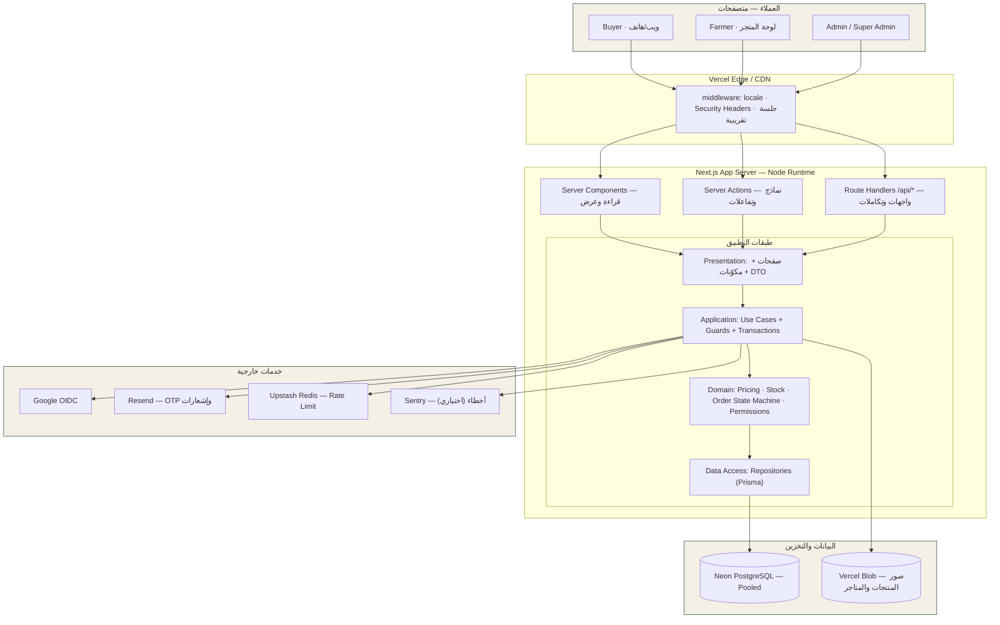

# 01 — التحليل المعماري والقرارات التقنية

> **AgriDirect** — سوق زراعي جزائري متعدد البائعين · `Du champ à votre table`
> المرحلة 1 (تحليل وتخطيط) — لا يتضمن هذا المستند أي كود تطبيقي.

---

## 1. نطاق هذه المرحلة

| البند | الحالة |
|---|---|
| تحليل المتطلبات واستخراج القدرات (Capabilities) | ✅ منجز في هذا المستند |
| اختيار التقنيات وتوثيق المبررات (ADR) | ✅ منجز |
| مخطط المعمارية وحدود الثقة | ✅ منجز |
| ERD وتصميم قاعدة البيانات | ✅ `02-data-model.md` |
| مصفوفة RBAC | ✅ `03-rbac.md` |
| Sitemap وتدفقات المستخدم | ✅ `04-ux-i18n-flows.md` |
| معمارية الأمان ونموذج التهديدات | ✅ `05-security.md` |
| خطة تنفيذ مرحلية قابلة للاختبار | ✅ `06-roadmap.md` |
| كود التطبيق / قاعدة البيانات / نشر | ⛔ يبدأ بعد اعتمادك للخطة (المرحلة 2+) |

**ملاحظة صدق:** لم يُشغّل أي اختبار في هذه المرحلة لأن لا يوجد كود بعد. أي رقم أداء أو نتيجة اختبار سيُنشر لاحقًا يكون **مقيسًا فعليًا**، لا مُقدَّرًا.

---

## 2. من المتطلبات إلى القدرات

| القدرة | ما تعنيه تقنيًا | المرحلة |
|---|---|---|
| الهوية والمصادقة | Google OIDC + Email OTP (6 أرقام، Hash، محاولات محدودة) + جلسات DB قابلة للإبطال | 4 |
| الصلاحيات | RBAC قائم على أكواد صلاحيات (`resource:action:scope`) يُفرض في الخادم | 3–4 |
| متجر المزارع | ملف متجر + تحقق إداري + حالة متجر تحكم النشر والطلبات | 5 |
| الكتالوج | تصنيفات شجرية + منتجات + صور + مخزون + حالات منتج | 5 |
| الطلب متعدد البائعين | `orders` (رئيسي) → `seller_orders` (فرعي لكل متجر) → `order_items` | 5 |
| المخزون والتزامن | خفض ذرّي شرطي داخل Transaction، ومنع Overselling | 5 |
| التوصيل | ولايات/بلديات + مناطق توصيل + أسعار لكل متجر وولاية | 3, 5 |
| الثقة | تقييمات مشترطة بشراء مُسلَّم (`order_item_id` فريد) | 5 |
| الإشراف | مراجعة مزارعين/منتجات + بلاغات + نزاعات + Audit Log | 5 |
| التقارير | استعلامات تجميع على بيانات فعلية (لا أرقام ثابتة) | 5 |
| التعددية اللغوية | `ar` / `fr` / `en` مع RTL/LTR وتنسيق أرقام وتواريخ | 2 |
| الأمان | Threat Model، رفع ملفات آمن، Rate Limiting، سجلات تدقيق | 4 |

**مبدأ غير قابل للتفاوض:** قاعدة البيانات تبدأ فارغة من بيانات النشاط التجاري (لا مزارعين/منتجات/طلبات/تقييمات). يُسمح فقط بـ **بيانات مرجعية** (ولايات، بلديات، تصنيفات، طرق توصيل، إعدادات افتراضية) لأنها جزء من تعريف النظام لا نشاط تجاري وهمي.

---

## 3. القرارات المعمارية (Architecture Decision Records)

| # | القرار | البديل المرفوض | السبب |
|---|---|---|---|
| ADR-001 | **Modular Monolith** داخل Next.js واحد، مع فصل طبقات صارم | Microservices / Backend منفصل | فريق صغير، إطلاق سريع، نقل بيانات داخل Transactions بسيط. الفصل الداخلي يسمح باستخراج خدمة لاحقًا دون إعادة كتابة الواجهات |
| ADR-002 | **Next.js App Router** + RSC افتراضيًا + Client Components عند الحاجة فقط | SPA (Vite) + API منفصل | SEO للسوق والمنتجات، تقليل JS، نموذج نشر واحد على Vercel، دعم i18n/RTL على الخادم |
| ADR-003 | **Prisma ORM** + SQL خام مُدار عبر Migrations للحالات الحرجة | Drizzle / TypeORM / SQL يدوي | Migrations ناضجة وقابلة للتتبع، توليد أنواع دقيق، علاقات معقدة مقروءة. Drizzle بديل قوي لكنه يفقد نضج سجل الترحيل وتجربة العلاقات المتعددة؛ نحتاجه فقط في استعلامات التقارير → مسار `$queryRaw` موثق |
| ADR-004 | **Better Auth** (Google OIDC + Email OTP + جلسات DB) | Auth.js / Clerk / بناء يدوي | OTP مُخزَّن مُهشَّر وجلسات قابلة للسرد والإبطال ومحدِّد معدل مدمج = مطابقة مباشرة للمتطلبات؛ Clerk يخرج البيانات الحساسة خارج سيطرتنا ويربط المنصة بمزود مدفوع |
| ADR-005 | **الخادم هو مصدر الحقيقة** للأسعار والمخزون والإجماليات | حساب في المتصفح ثم إرساله | منع التلاعب بالسعر/الكمية؛ المتصفح يرسل `productId + qty` فقط، والخادم يعيد الحساب ويقارن الإجمالي المقترح (يكشف تغيّر السعر → 409) |
| ADR-006 | **تقسيم الطلب متعدد البائعين**: `orders` + `seller_orders` من اليوم الأول | طلب مسطح لكل منتج | كل مزارع يدير ويشحن ويؤكد طلبه فقط، دون رؤية أو تعديل بيانات مزارع آخر؛ ويسهّل العمولة والتوصيل لكل متجر |
| ADR-007 | **Numeric(12,2) + decimal.js** لكل المبالغ، ولا `float` أبدًا | `int` سنتيمات / `float` | مطابقة متطلبك؛ `decimal.js` يمنع أخطاء الفاصلة العائمة. العملة محفوظة مع الطلب (`currency`) لتمكين عملات مستقبلًا |
| ADR-008 | **الجغرافيا كبيانات** (`wilayas`, `communes`) لا ثوابت في الكود | Enum/قائمة مضمّنة | إضافة ولاية/بلدية/منطقة دون Migration هيكلي أو إعادة نشر |
| ADR-009 | **Locale prefix في المسار** (`/{locale}/...`) عبر `next-intl` | Cookie فقط | روابط قابلة للمشاركة والفهرسة لكل لغة، RSC-friendly، `dir` يُحسب على الخادم |
| ADR-010 | **تخزين الصور في Object Storage** (Vercel Blob) + `next/image` بقائمة نطاقات مسموحة | رفع داخل الـ repo / صور Base64 في DB | أداء وتسليم CDN، فصل الملفات عن قاعدة البيانات، إمكانية الاستبدال بـ Cloudinary دون تغيير الواجهات |
| ADR-011 | **RBAC بأكواد صلاحيات** مرتبطة بأدوار في قاعدة البيانات | `if (role === 'admin')` مبعثر | إمكانية إضافة Admin فرعي بصلاحيات محدودة لاحقًا دون تعديل كل الملفات (Super Admin يمنح/يسحب) |
| ADR-012 | **Audit Log مُلحَق فقط** (append-only) | سجل في ملفات/Logs | متطلب رقابي؛ يُمنع UPDATE/DELETE على الجدول عبر صلاحيات قاعدة البيانات |
| ADR-013 | **لا دفع إلكتروني في v1** — COD فقط مع كيان `payments` جاهز | بوابة وهمية | ممنوع عرض نجاح دفع غير حقيقي؛ البنية تحمل `provider` و`status` لتكامل SATIM/Edahabia لاحقًا |
| ADR-014 | **التحقق من الصلاحيات والملكية في Repository/Use-Case لا في الواجهة** | إخفاء الأزرار | منع IDOR/BOLA عبر طلبات API مباشرة |
| ADR-015 | **Idempotency Key** لإنشاء الطلب | لا شيء | منع الطلبات المكررة عند إعادة الإرسال/التحديث المزدوج |

---

## 4. حزمة التقنيات (Tech Stack) — إصدارات مثبتة ومُتحقَّق منها من npm registry بتاريخ 2026-11-11

| الطبقة | التقنية | الإصدار | المبرر |
|---|---|---|---|
| Framework | `next` | 16.4.6 | App Router، RSC، Server Actions، نشر مباشر على Vercel |
| UI runtime | `react` / `react-dom` | 19.3.1 | متوافق مع Next 16، `useActionState`، تحسين النماذج |
| اللغة | `typescript` | 7.0.2 | `strict`, `noUncheckedIndexedAccess`, `exactOptionalPropertyTypes` |
| التنسيق | `tailwindcss` | 4.3.5 | Tokens كمتغيرات CSS، لاConfig ثقيل، طبقات مكوّنات |
| البدائيات التفاعلية | Radix UI primitives | latest | إتاحة (a11y) وحوارات/قوائم وقوائم منسدلة موثوقة دون قيود تصميمية |
| الأيقونات | `lucide-react` | latest | خطي، متسق، خفيف (لا أيقونات كائنات حيّة) |
| الخطوط | `next/font/google` | — | Tajawal (ar) + Inter (fr/en)، تحميل محلي مُحسَّن، `display: swap` |
| ORM | `prisma` / `@prisma/client` | 7.10.1 | ADR-003 |
| Driver | `pg` (pooled) + `@neondatabase/serverless` للقراءة | latest / 1.2.0 | Pooler ضروري لـ Transactions التفاعلية على Serverless |
| Auth | `better-auth` | 1.7.21 | ADR-004 |
| Validation | `zod` | 4.6.7 | Schema واحدة للعميل والخادم + تحويل DTO آمن |
| i18n | `next-intl` | 4.15.0 | RSC + `dir` + تنسيق أرقام/تواريخ حسب Locale |
| Money | `decimal.js` | latest | ADR-007 |
| Hash (OTP/كلمات مرور) | `@node-rs/argon2` (Argon2id) fallback `bcrypt` | latest | خوارزمية معتمدة، لا اختراع تشفير |
| Rate limit | `@upstash/ratelimit` + Redis | latest | موزَّع بين Serverless instances. **يتطلب حساب Upstash** — البديل المؤقت: limiter على Postgres |
| Email | `resend` | latest | واجهة برمجية بسيطة + قوالب React Email. **يتطلب مفتاح API** |
| Media | `@vercel/blob` | latest | ADR-010. **يتطلب توكن Blob** |
| Logging | `pino` | latest | JSON logs، تنقيح حقول حساسة |
| Errors (اختياري) | `@sentry/nextjs` | latest | تتبع أخطاء Production. **يتطلب حساب/DSN** |
| Tests | `vitest` 5.1.0 · `@testing-library/react` · `@playwright/test` 1.65.0 | | وحدة/تكامل سريعة + E2E حقيقي على متصفح |
| الجودة | ESLint 9 (flat) · Prettier · `tsc --noEmit` · husky · lint-staged · commitlint | | بوابات جودة في CI |

**التزام:** تُثبَّت الإصدارات في `package.json` بدقة (بدون `^`) وتُسجَّل في `pnpm-lock.yaml` لتكرار البناء.

### ما لم نختَر ولماذا
- **Drizzle**: مرونة SQL أعلى، لكن سجل الترحيل وتجربة العلاقات في Prisma أنسب لفريق سيضيف جداول كثيرة سريعًا. استعلامات التقارير تُكتب SQL خام عند الحاجة.
- **Supabase**: يقدّم Auth/Storage جاهزين، لكنه يفرض نموذج صلاحياته (RLS) بجانب RBAC المطلوب، ويجعل منطق الأعمال موزعًا بين Postgres والكود. نبقى على Neon + طبقة خدمات واضحة.
- **Stripe/Paddle**: غير متوفرين للدفع الجزائري COD-first؛ مؤجلان بقرار ADR-013.
- **Zustand/Redux**: لا حاجة لحالة عامة معقّدة؛ السلة تُحفظ في قاعدة البيانات (مستخدم مسجّل) وتُدار بـ Server Actions.

---

## 5. مخطط المعمارية (Architecture Diagram)



### حدود الثقة (Trust Boundaries)
1. **المتصفح غير موثوق بالكامل.** كل تحقق يُعاد على الخادم: السعر، الكمية، الإجمالي، الملكية، الصلاحية، حالة الحساب.
2. **Edge ≠ مصدر صلاحية.** الـ middleware يضبط اللغة والرؤوس ويعمل فحصًا تقريبيًا للجلسة، لكن **كل** عملية حساسة تعيد التحقق داخل الـ Use Case.
3. **قاعدة البيانات** لا تُفتح للعامة؛ الوصول عبر Pooler ببيانات اعتماد خاصة بالخادم فقط.
4. **الملفات** تُخزَّن خارج شجرة التطبيق، والوصول إليها عبر CDN مع مفاتيح عشوائية.

---

## 6. الطبقات — قواعد إلزامية

| الطبقة | مسؤوليتها | ممنوع فيها |
|---|---|---|
| **Presentation** (`src/app`, `src/components`) | العرض، النماذج، حالات Loading/Empty/Error، تنسيق التواريخ والأسعار | أي استعلام DB مباشر، أي `if role === ...`، أي حساب مبالغ نهائي |
| **Application** (`src/server/use-cases`) | تنسيق العملية، فتح Transaction، استدعاء Guards، إرسال إشعارات، كتابة Audit | JSX، تفاصيل SQL |
| **Domain** (`src/server/domain`) | قواعد نقية قابلة للاختبار: آلة حالات الطلب، سياسة المخزون، حساب العمولة والإجماليات، مطابقة الصلاحيات | أي I/O (لا Prisma ولا fetch) — لتسهيل Unit Tests |
| **Data Access** (`src/server/repositories`) | Prisma، استعلامات، Pagination، Indexes، تحويل السجلات إلى DTO | قواعد عمل، تحقق صلاحيات |
| **Validation** (`src/schemas`) | Zod لكل مدخل: body، query، params | منطق عمل |
| **Auth & AuthZ** (`src/server/auth`, `src/server/authorization`) | الجلسة، الدور، أكواد الصلاحيات، `requirePermission` | — |

### مسار الطلب الكامل
```
HTTP / Server Action
 → middleware (locale, headers)
 → helper: getSession() + requireUser()
 → Zod.parse(input)                         // 400 عند الفشل، رسائل مترجمة
 → requirePermission(actor, 'code')         // 403
 → Use Case: loadResource + assertOwnership  // 404 للغير مملوك (لا تسريب وجود)
 → Domain policy (state machine / stock / price)
 → Repository + Transaction                 // 409 عند تعارض المخزون/السعر
 → Audit Log + Notification
 → DTO → Presentation
```
كل خطأ يمر بـ `AppError` مصنَّف (`AuthError`, `PermissionError`, `ValidationError`, `ConflictError`, `NotFoundError`, `RateLimitError`, `InternalError`) ويُحوَّل إلى رد آمن موحّد: `{ error: { code, message, fields? } }` بلا Stack Trace في الإنتاج.

### قرارات عرضية (Cross-cutting)
- **المعرفات:** UUID v7 (قابل للفرز زمنيًا، أفضل للفهارس من v4) لكل الكيانات، مع `order_number` مقروء للبشر.
- **الوقت:** كل السجلات `timestamptz` بـ UTC، والعرض حسب Locale/Timezone (`Africa/Algiers`).
- **الحذف:** Soft delete (`deleted_at`) للمنتجات والمتاجر والعناوين والتصنيفات؛ **ممنوع** على الطلبات والمدفوعات والسجلات المالية والتدقيق.
- **الصور:** تُحفظ بأسماء عشوائية، والحد الأقصى 5MB، ونوع MIME مُتحقَّق من البايتات (Magic Bytes) لا من الامتداد.
- **الترجمة:** لا نص واجهة داخل المكوّنات؛ كل النصوص في `src/i18n/messages/{ar,fr,en}.json` مع `ICU` للجمع والتعدد.

---

## 7. هيكل المشروع (Folder Structure)

```
agridirect/
├─ .github/workflows/ci.yml          # lint · typecheck · unit · integration · e2e · build
├─ .env.example
├─ docs/
│  ├─ phase-1/                       # خطة هذه المرحلة
│  ├─ adr/                           # قرارات معمارية مفردة عند إضافتها
│  └─ operations/runbook.md          # نشر، تراجع، نسخ احتياطي
├─ prisma/
│  ├─ schema.prisma
│  ├─ migrations/                    # سجل migrations قابل للتتبع
│  └─ seed/                          # بيانات مرجعية فقط: ولايات · بلديات · تصنيفات · توصيل
├─ public/
│  └─ images/editorial/              # صور تحريرية مُرخَّصة (Hero/التصنيفات) مع سجل ترخيص
├─ src/
│  ├─ app/
│  │  ├─ [locale]/
│  │  │  ├─ (public)/                # الرئيسية · السوق · المنتج · المتجر · الصفحات الثابتة
│  │  │  ├─ (auth)/                  # دخول · OTP · مزارع جديد
│  │  │  ├─ (buyer)/                 # حسابي · السلة · Checkout · طلباتي · المفضلة
│  │  │  ├─ (farmer)/dashboard/      # لوحة المزارع كاملة
│  │  │  └─ (admin)/admin/           # لوحة الإدارة
│  │  ├─ api/                        # Route Handlers (auth, uploads, webhooks, reports)
│  │  ├─ layout.tsx                  # dir/lang ديناميكي
│  │  ├─ robots.ts · sitemap.ts · not-found.tsx · error.tsx
│  ├─ components/
│  │  ├─ ui/                         # Button · Input · Dialog · Table · Badge · Toast …
│  │  ├─ layout/                     # Header · Footer · Sidebar · LocaleSwitcher
│  │  ├─ product/ · cart/ · order/ · forms/
│  │  └─ feedback/                   # Loading · EmptyState · ErrorState · Skeleton
│  ├─ features/                      # مكوّنات مركبة لكل نطاق (catalog, checkout, admin-users …)
│  ├─ server/
│  │  ├─ auth/                       # better-auth config · session helpers · OTP
│  │  ├─ authorization/              # permissions catalog · guards · policies
│  │  ├─ domain/                     # order-state-machine · pricing · inventory-policy · money
│  │  ├─ use-cases/                  # {catalog,checkout,orders,stores,admin,reviews,disputes}
│  │  ├─ repositories/               # Prisma access، scoped queries
│  │  ├─ db/                         # prisma client · transaction helper
│  │  ├─ security/                   # rate-limit · headers · csrf · upload-validation · redaction
│  │  ├─ notifications/ · audit/ · container.ts
│  │  └─ errors/
│  ├─ schemas/                       # Zod: product, order, checkout, admin, auth
│  ├─ lib/                           # utils نقية: format-date, money-format, slug, cn
│  ├─ i18n/                          # routing · messages/{ar,fr,en}.json · request config
│  ├─ hooks/                         # useCartOptimistic · useMediaQuery …
│  ├─ types/                         # DTOs وأنواع مشتركة
│  ├─ config/                        # site · roles · feature-flags · constants
│  └─ styles/                        # globals.css · tokens.css
├─ tests/
│  ├─ unit/ · integration/ · security/ · e2e/
└─ scripts/                          # create-admin.ts · verify-rbac.ts · check-images.ts
```

**لماذا هذا الهيكل؟** الجذر يفصل بحسب **الطبقة التقنية** (`app`, `components`, `server`, `schemas`) وبحسب **النطاق** داخل `features` و`server/use-cases`، ما يمنع الملفات الضخمة ويمنع تسرب Prisma إلى الواجهة. لا نستخدم `src/pages` ولا `src/services` منفصلة، لأن الـ Use Cases في `server/use-cases` هي طبقة الخدمات نفسها مع تسمية أدق.

---

## 8. ما هو خارج نطاق الإصدار الأول (صراحةً)

| خارج النطاق | سبب التأجيل | جاهزية التوسع |
|---|---|---|
| الدفع الإلكتروني (SATIM / CIB / Edahabia) | يتطلب حساب تاجر وعقد مع مزود دفع | `payments.provider` + `payment_status` + حالة `unpaid` |
| تطبيق موبايل أصلي | الويب Responsive يغطي الاحتياج | API/RSC منفصل عن العرض |
| دردشة فورية | تكلفة تشغيل عالية | `dispute_messages` + إشعارات |
| تقييم المتجر (نجوم للمزارع) | لتقليل التلاعب في الإصدار الأول | جدول `reviews` يحمل `store_id` |
| برامج الولاء/الكوبونات | تعقيد محاسبي | `platform_settings` و`discount_total` جاهزان |
| SMS | تكلفة ومزود محلي | `notification_channel` enum |
| تعدد العملات | الجزائر DZD فقط حاليًا | `currency` على الطلبات والأسعار |
| تخزين مؤقت للكتالوج عبر CDN | البيانات متغيّرة والمخزون حسّاس | `revalidateTag` جاهز عند الحاجة |

**نقطة تحتاج قرارك:** متطلبك يذكر **69 ولاية**، بينما التقسيم الإداري الجزائري الرسمي (بعد إنشاء 10 ولايات جديدة سنة 2021) هو **58 ولاية و1541 بلدية**. صمّمنا الجغرافيا كبيانات لا كثوابت، لذا تستطيع إضافة أي عدد لاحقًا دون تغيير الكود. القرار المطلوب: نبذر 58 ولاية رسمية أم قائمة أخرى عندك؟ (سؤال مؤجل إلى نهاية الخطة).

---

## 9. معايير الهندسة الملزمة أثناء التنفيذ

1. `strict: true` + `noUncheckedIndexedAccess` + منع `any` (قاعدة ESLint `no-explicit-any: error`، واستثناء موثّق فقط عند حدود مكتبة خارجية).
2. كل ملف ≤ ~250 سطرًا، وكل دالة Use Case تفعل شيئًا واحدًا.
3. لا استعلام داخل حلقة (منع N+1) — تحميل بالعلاقات أو `IN (...)`.
4. كل صفحة تملك `loading.tsx` / `error.tsx` / حالة فراغ حقيقية.
5. كل زر يظهر في الواجهة ينفذ عملية موجودة فعلًا، أو يظهر معطّلًا بسبب واضح (مثال: «الدفع الإلكتروني غير متاح بعد»).
6. Definition of Done لأي شريحة: كود + Validation + Guard + Audit (إن حسّاس) + اختبارات + ترجمة `ar/fr/en` + مراجعة وصول.
7. لا أسرار في Git؛ `.env.example` فقط، والتحقق من متغيرات البيئة عند الإقلاع عبر Zod.
