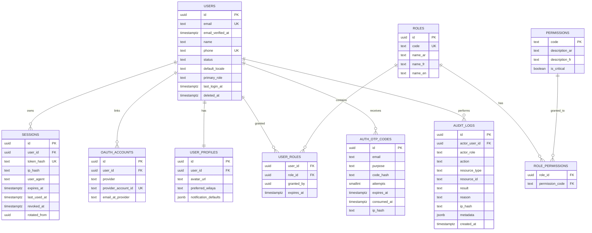
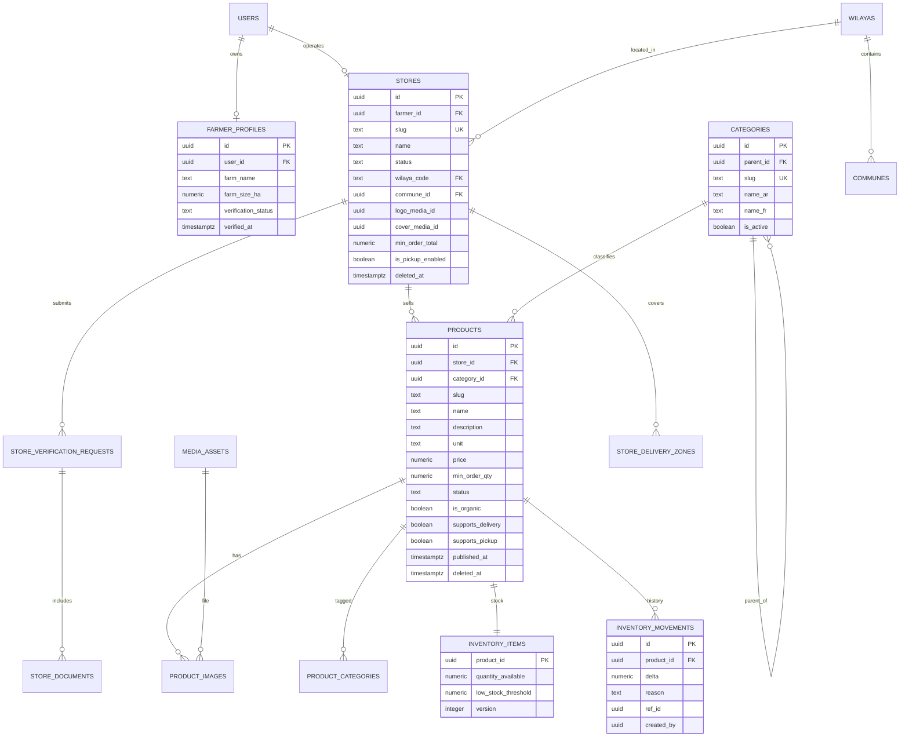
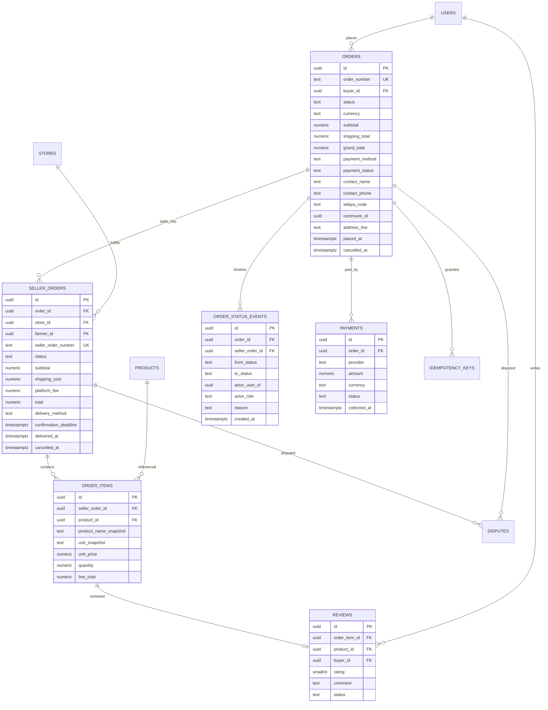
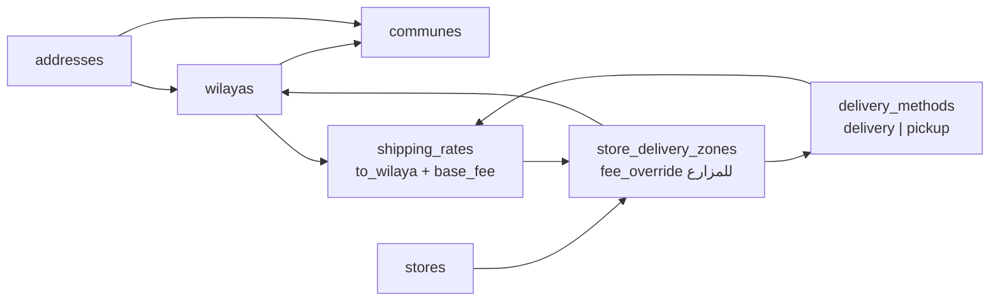

# 02 — تصميم قاعدة البيانات (ERD + المواصفات)

> PostgreSQL 16 على Neon · Prisma 7 · UUID v7 · `numeric(12,2)` للمال · DZD
> **لا بيانات نشاط تجاري في البذور.** البذور = بيانات مرجعية فقط.

---

## 1. المخطط الكلي (نظرة سريعة)

| المجموعة | الجداول |
|---|---|
| الهوية والصلاحيات | `users` · `user_profiles` · `oauth_accounts` · `sessions` · `auth_otp_codes` · `roles` · `permissions` · `role_permissions` · `user_roles` |
| الجغرافيا والتوصيل | `wilayas` · `communes` · `addresses` · `delivery_methods` · `shipping_rates` · `store_delivery_zones` |
| المزارع والمتجر | `farmer_profiles` · `stores` · `store_verification_requests` · `store_documents` |
| الكتالوج والمخزون | `categories` · `products` · `product_images` · `product_categories` · `inventory_items` · `inventory_movements` |
| التجارة | `carts` · `cart_items` · `orders` · `seller_orders` · `order_items` · `order_status_events` · `payments` · `idempotency_keys` |
| الثقة والإشراف | `reviews` · `favorites` · `reports` · `disputes` · `dispute_messages` |
| المنصة | `notifications` · `notification_preferences` · `media_assets` · `platform_settings` · `audit_logs` |

---

## 2. ERD — الهوية والصلاحيات



**قرار:** `users.primary_role` عمود مساعد للتوجيه والعرض السريع، لكن **الصلاحيات تُقرأ من `user_roles` → `role_permissions`** فقط. لا يُعتمد العمود في أي قرار أمني (يمنع التلاعب ويسمح بأدوار متعددة).

---

## 3. ERD — المزارع، الكتالوج، المخزون



### حالات الكيانات (Enums)

| Enum | القيم | ملاحظة |
|---|---|---|
| `user_status` | `active` · `suspended` · `deactivated` | التعليق يمنع الدخول والبيع فورًا |
| `store_status` | `draft` · `pending_verification` · `active` · `rejected` · `suspended` | النشر والطلبات تتطلب `active` |
| `verification_status` | `unsubmitted` · `pending` · `approved` · `rejected` · `needs_info` | مع سبب إلزامي عند الرفض |
| `product_status` | `draft` · `pending_review` · `published` · `rejected` · `out_of_stock` · `archived` | `out_of_stock` مشتق من المخزون ويُضبط آليًا |
| `inventory_reason` | `restock` · `manual_adjustment` · `order_placed` · `order_cancelled` · `order_returned` · `damage` | كل تغيير مخزون له حركة |
| `media_purpose` | `product` · `store_logo` · `store_cover` · `category` · `editorial` · `dispute_evidence` | يحدد قواعد الوصول |
| `media_status` | `pending` · `approved` · `rejected` | لا يُعرض غير المعتمد |

---

## 4. ERD — الطلبات، التوصيل، الدفع



---

## 5. مواصفات الجداول الحرجة

### 5.1 `products`
- `slug` فريد **داخل المتجر**: `UNIQUE (store_id, slug)` — يمنع أيضًا تصادم روابط المنتجات بين مزارعين.
- `price` `NUMERIC(12,2) CHECK (price > 0)` — لا سعر صفر أو سالب.
- `min_order_qty` `NUMERIC(10,3) CHECK (min_order_qty > 0)` — يدعم 0.5 كغ.
- `CHECK (supports_delivery OR supports_pickup)` — يجب توفير طريقة استلام واحدة على الأقل.
- `FOREIGN KEY (store_id) REFERENCES stores(id) ON DELETE RESTRICT` — لا حذف متجر له منتجات نشطة، بل أرشفة.
- `FOREIGN KEY (category_id) REFERENCES categories(id) ON DELETE RESTRICT` — يمنع حذف تصنيف مستخدم.
- `deleted_at` Soft delete + `status = 'archived'`، والمنتج المحذوف يبقى ظاهرًا في الطلبات التاريخية عبر Snapshot.

### 5.2 `inventory_items` + `inventory_movements`
- المخزون في جدول منفصل عن المنتج: يفصل بيانات العرض عن حالة التوفر، ويمنع فقدان تاريخ الحركة.
- `quantity_available NUMERIC(10,3) NOT NULL CHECK (quantity_available >= 0)` — قيد قاعدة بيانات يمنع السالب حتى في حال خطأ برمجي.
- كل تغيير يمر بـ Use Case واحد يكتب سجل حركة في نفس Transaction.

### 5.3 `orders` / `seller_orders` / `order_items`
- `orders` = الاتفاقية التجارية الكاملة للمشتري (عنوان، توصيل، دفع).
- `seller_orders` = وحدة العمل للمزارع (قبول، تجهيز، شحن، إلغاء مستقل).
- `order_items` تحمل **Snapshot** للاسم والوحدة والسعر، فلا يتغير الطلب التاريخي إذا عدّل المزارع منتجه لاحقًا.
- `UNIQUE (order_id, store_id)` في `seller_orders` يضمن طلبًا فرعيًا واحدًا لكل متجر.
- `seller_order_number` = `AD-YYYY-NNNNNN-S` (S = ترتيب المتجر داخل الطلب) فريد.
- `CHECK (grand_total = subtotal + shipping_total - discount_total)` كطبقة أمان إضافية بعد حساب الخادم.
- السجلات المالية والطلبات: **لا حذف، لا Soft delete**. الإلغاء = حالة + سبب + حدث.

### 5.4 `reviews`
- `order_item_id UUID UNIQUE NOT NULL` — **تقييم واحد لكل سطر شراء** (يمنع التقييمات الوهمية والمكررة بنيويًا).
- `CHECK (rating BETWEEN 1 AND 5)`.
- لا يُنشأ إلا إذا كانت `seller_orders.status = 'delivered'` وكان `order_items` يخص المشتري — يُتحقق في Use Case أيضًا لا في القيد فقط.
- `status`: `published` · `hidden` (مخفي إداريًا بسبب) — لا حذف فعلي إلا بحذف المستخدم لرأيه وفق السياسة (`deleted_at`).

### 5.5 `media_assets`
- `storage_key` عشوائي (`uuid` + امتداد مشتق من MIME)، `checksum_sha256` لمنع التكرار العبثي.
- `owner_user_id` + `store_id`/`product_id` لفرض الملكية عند العرض والحذف.
- `status` يبدأ `pending`؛ لا يُعرض للعامة قبل التحقق من النوع والحجم.

### 5.6 `platform_settings`
- `key` (مثل `product_moderation_mode`, `platform_fee_rate`, `order_confirmation_hours`, `max_upload_bytes`) و`value jsonb`.
- `is_critical = true` ⇒ التعديل يتطلب `super:settings:write_critical` **و**سببًا في Audit Log.

---

## 6. الفهارس (Indexes) — مبرَّرة بكل استعلام متوقع

| # | الفهرس | الاستعلام المخدوم |
|---|---|---|
| 1 | `users (email)` UQ | الدخول بـ OTP/Google |
| 2 | `users (status, primary_role)` | فلاتر إدارة المستخدمين |
| 3 | `sessions (user_id, revoked_at, expires_at)` | «جلساتي النشطة» + التحقق |
| 4 | `sessions (token_hash)` UQ | التحقق من كل طلب مصادق |
| 5 | `auth_otp_codes (email, purpose, created_at DESC)` | آخر رمز + حد المحاولات |
| 6 | `products (status, deleted_at, published_at DESC)` | السوق والصفحة الرئيسية |
| 7 | `products (store_id, status)` | لوحة المزارع + صفحة المتجر |
| 8 | `products (category_id, status)` | تصفية التصنيف |
| 9 | `products (slug)` UQ | صفحة المنتج |
| 10 | `products` GIN على `to_tsvector(name, description)` | البحث النصي (بدل `LIKE %…%`) |
| 11 | `products (price)` | ترتيب/تصفية بالسعر |
| 12 | `inventory_items (quantity_available)` WHERE > 0 | «المتوفر فقط» |
| 13 | `orders (buyer_id, placed_at DESC)` | طلباتي |
| 14 | `orders (status, placed_at DESC)` | لوحة الإدارة + الطلبات المتأخرة |
| 15 | `orders (order_number)` UQ | البحث برقم الطلب |
| 16 | `seller_orders (store_id, status, created_at DESC)` | طلبات المزارع |
| 17 | `order_items (product_id)` | الأكثر طلبًا + تقييمات المنتج |
| 18 | `reviews (product_id, status, created_at DESC)` | تقييمات المنتج |
| 19 | `audit_logs (resource_type, resource_id, created_at DESC)` | سجل كيان |
| 20 | `audit_logs (actor_user_id, created_at DESC)` | سجل مشرف |
| 21 | `notifications (user_id, read_at, created_at DESC)` | مركز الإشعارات |
| 22 | `shipping_rates (method_id, to_wilaya_code)` | حساب التوصيل |
| 23 | `communes (wilaya_code)` | قوائم البلديات |
| 24 | `disputes (status, created_at DESC)` | صندوق النزاعات |

**قاعدة:** كل استعلام متكرر جديد ⇒ يُنشأ فهرسه في نفس PR، ويُتحقق بـ `EXPLAIN (ANALYZE, BUFFERS)` على بيانات اختبار ضخمة قبل الإنتاج.

---

## 7. التزامن ومنع Overselling

### 7.1 قرار: خفض ذرّي شرطي (Conditional Atomic Update) لا قفل على مستوى الجلسة
```sql
UPDATE inventory_items
   SET quantity_available = quantity_available - $1,
       version = version + 1,
       updated_at = now()
 WHERE product_id = $2
   AND quantity_available >= $1
RETURNING quantity_available, version;
```
- إن عاد صف واحد ⇒ نجح الحجز. إن عاد **صفر** ⇒ المخزون غير كافٍ ⇒ نرجع الطلب كاملًا (`409`) مع قائمة المنتجات الناقصة.
- لا `SELECT` ثم `UPDATE` (سباق). لا `NOWAIT` يدوي. القيد `CHECK (>= 0)` هو الحاجز الأخير.
- عند الإلغاء/الرفض: حركة عكسية `+qty` في نفس معاملة تغيير الحالة.

### 7.2 قرار: الطلب متعدد المتاجر = معاملة واحدة All-or-Nothing
```
BEGIN
  1. تحقّق الجلسة + الحساب النشط + الإعدادات
  2. حجز idempotency_key (فريد) — إن موجود مسبقًا: أعد نفس استجابة الطلب (200)
  3. تحميل المنتجات + المتاجر + حالة المتجر + حالة المنتج + الحد الأدنى للطلب
  4. منع المنتج غير المنشور/الحساب المعلّق/المنتج المحذوف
  5. حساب لكل متجر: subtotal، توصيل (منطقة/سعر)، عمولة، total   ← كله في الخادم
  6. مقارنة الإجمالي المُرسل من العميل (اختياري) — إن اختلف: 409 PRICE_CHANGED
  7. خفض المخزون ذرّيًا لكل سطر — فشل أي سطر ⇒ ROLLBACK كامل
  8. INSERT orders + seller_orders + order_items + order_status_events
  9. INSERT payments (COD, unpaid)
 10. Audit + Notifications (داخل المعاملة أو Outbox بعدها)
COMMIT
```
> **قرار مقصود:** لا نقبل «الطلب الجزئي» (تجاهل منتج ناقص) في v1 لتجنّب مفاجآت للمشتري. الرسالة تُظهر بدقة المنتجات غير المتوفرة ليعيد المحاولة.

### 7.3 Idempotency
`idempotency_keys (user_id, scope, key)` Unique + `request_hash`. إعادة الإرسال تعيد **نفس** الطلب لا تنشئ آخر. تُنظَّف المفاتيح الأقدم من 24 ساعة بمهمة مجدولة.

---

## 8. آلة حالات الطلب (Domain State Machine)

**مستوى الطلب الرئيسي `orders.status`:** `pending` · `in_progress` · `completed` · `partially_cancelled` · `cancelled` · `disputed`
**مستوى المزارع `seller_orders.status`:** `pending` · `confirmed` · `preparing` · `ready_for_delivery` · `shipped` · `delivered` · `cancelled` · `rejected` · `disputed`

| من | إلى | الفاعل المسموح | الشروط |
|---|---|---|---|
| `pending` | `confirmed` | Farmer (المتجر) | متجر `active`، مخزون محجوز، داخل `confirmation_deadline` |
| `pending` | `rejected` | Farmer | سبب إلزامي ⇒ إرجاع مخزون |
| `pending` | `cancelled` | Farmer · Buyer · Admin | سبب؛ Admin يوثّق السبب في Audit |
| `confirmed` | `preparing` | Farmer | — |
| `preparing` | `ready_for_delivery` | Farmer | طريقة التوصيل محددة |
| `ready_for_delivery` | `shipped` | Farmer | توصيل فقط |
| `ready_for_delivery` | `delivered` | Buyer (تأكيد الاستلام) · Farmer · Admin | استلام من المزرعة أو توصيل |
| `shipped` | `delivered` | Buyer · Farmer (مع رقم تتبع) · Admin | — |
| `*` | `cancelled` | Admin فقط | قبل `delivered`؛ بسبب مسجَّل |
| `delivered` | — | — | نهائي (المسار الوحيد: نزاع ثم معالجة إدارية) |
| `pending/confirmed` | `disputed` | Buyer | مسموح فقط قبل الشحن |
| `shipped/delivered` | `disputed` | Buyer | خلال 7 أيام من التسليم |

- الانتقالات تُنفَّذ من `domain/order-state-machine.ts` (دالة نقية `canTransition(from, to, actor)`)، ويُختبر كل مسار مسموح وممنوع.
- كل انتقال يكتب `order_status_events` (من، إلى، الفاعل، الدور، السبب، الوقت).
- حالة `orders` الرئيسية **تُشتق** من حالات `seller_orders` (كلها cancelled ⇒ cancelled؛ كلها delivered ⇒ completed؛ خليط ⇒ partially_cancelled/in_progress)، وتُحدَّث في نفس المعاملة.

---

## 9. حسابات المال والعمولة

- كل العمليات في `src/server/domain/money.ts` باستخدام `Decimal` (لا `number`).
- `line_total = round(unit_price × quantity, 2)` — التقريب نصف-للأعلى فقط في الدالة الواحدة المشتركة.
- `platform_fee = round(subtotal × fee_rate, 2)`، وتُحفظ `fee_rate` **Snapshot** في `seller_orders` حتى لا يتغير تاريخيًا إذا عدّلت الإدارة النسبة.
- `total = subtotal + shipping_cost` (رسوم المنصة تُحسم من مستحقات المزارع، ولا تُضاف على المشتري — قرار قابل للتغيير من الإعدادات).
- العرض: `Intl.NumberFormat(locale, { style: 'currency', currency: 'DZD' })` — الأرقام تُخزَّن كأرقام، والتنسيق للعرض فقط.

---

## 10. الجغرافيا والتوصيل



- **قاعدة الحساب:** إن وُجد `store_delivery_zones` مطابق ⇒ استخدم `fee_override` أو سعر الجدول. وإلا ⇒ `shipping_rates` العامة. وإلا ⇒ التوصيل غير متاح لهذه الولاية (لا نخترع سعرًا).
- الاستلام من المزرعة: `stores.is_pickup_enabled` + عنوان الاستلام، وتكلفته صفر مع إظهار ذلك صراحةً.
- `UNIQUE` على `(method_id, from_wilaya_code, to_wilaya_code)` يُدار بفهرسين جزئيين لتفادي مشكلة `NULL` في Postgres.

---

## 11. الترحيلات (Migrations) والبذور

| البند | السياسة |
|---|---|
| التطوير | `prisma migrate dev` على فرع Neon مستقل (Branch لكل مطور إن أمكن) |
| الإنتاج | `prisma migrate deploy` فقط ضمن CI، مع نسخة/فرع احتياطي قبل الترحيل |
| `db push` | **ممنوع** على أي بيئة مشتركة أو إنتاج |
| قيود لا يدعمها Prisma | `CHECK`, `REVOKE`, `CREATE EXTENSION`, فهارس GIN ⇒ ملف SQL خام داخل نفس مجلد الـ migration |
| البيانات المرجعية | `prisma/seed/` idempotent: **69 ولاية و1541 بلدية** (القانون 26-06) + تصنيفات أساسية + طرق توصيل + إعدادات افتراضية |
| حماية «قاعدة فارغة» | `scripts/verify-empty.ts` يفشل إذا وُجد أي سجل في `users/products/orders/reviews` خارج حساب الأدمن الذي أنشأه المالك |
| حساب الأدمن الأول | `scripts/create-admin.ts` تفاعلي: يطلب البريد، ينشئ المستخدم ويُسند `super_admin`، ثم يُرسل OTP/دعوة. **لا كلمة مرور افتراضية، ولا بيانات دخول في الكود أو المستودع** |
| التراجع | كل migration قابلة للتراجع يدويًا بملف `down.sql` موثّق للعمليات الخطرة فقط |

**محسوم:** 69 ولاية وفق القانون 26-06 (أفريل 2026)؛ البذور ستُبنى على قائمة رسمية مصدرها الجريدة الرسمية. التصميم لا يتغير مهما تغيّر العدد.
