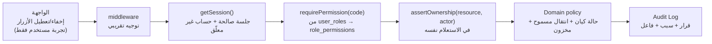

# 03 — نظام الأدوار والصلاحيات (RBAC Matrix)

> المبدأ: **لا صلاحية بالواجهة.** كل كود صلاحية يُفحص في الخادم داخل الـ Use Case، مرة واحدة، عبر `requirePermission(actor, code, resource?)`.
> الأدوار ليست Enum في الكود فقط، بل صفوف في `roles` مع `permissions` مرتبطة، ليمكن منح Admin فرعي صلاحيات محدودة لاحقًا دون تعديل الشيفرة.

---

## 1. الأدوار

| الدور | `code` | من يمنحه | ملخص النطاق |
|---|---|---|---|
| مشترٍ | `buyer` | تلقائيًا عند التسجيل | يشتري، يدير طلباته وعناوينه وتقييماته فقط |
| مزارع | `farmer` | تلقائيًا عند إنشاء متجر، ويُحدَّد `store_status` بواسطة التحقق الإداري | يدير متجره ومنتجاته وطلبات متجره فقط |
| مدير | `admin` | `super_admin` فقط | إشراف على المستخدمين والمحتوى والطلبات والتقارير — **بلا** صلاحيات حساسة |
| مدير أعلى | `super_admin` | حساب التهيئة الأول / `super_admin` آخر | كل صلاحيات `admin` + إدارة المشرفين والأمان والإعدادات الحساسة وسجل التدقيق الكامل |

- المشتري قد يصبح مزارعًا (يُضاف دور ثانٍ) **دون** فقدان حسابه أو طلباته السابقة.
- **ممنوع** أن يحمل المستخدم `super_admin` و`farmer` معًا في v1 (فصل مسؤوليات) — يُمنع بقيد في Use Case ويُسجَّل في Audit عند المحاولة.
- `admin` لا يستطيع تعديل `super_admin` ولا رؤية بياناته الحساسة.

---

## 2. كتالوج أكواد الصلاحيات

الصيغة: `domain:action[:scope]`.

### المشتري (متاحة لكل مستخدم مصادق)
| الكود | الوصف |
|---|---|
| `cart:manage:own` | إدارة سلة نفسه |
| `order:create:own` | إنشاء طلب |
| `order:read:own` | قراءة طلباته |
| `order:cancel:own` | إلغاء طلبه وفق الحالة |
| `review:write:own` | تقييم بعد تسليم مؤكد |
| `review:moderate:own` | تعديل/حذف تقييمه |
| `address:manage:own` | عناوينه |
| `favorite:manage:own` | المفضلة |
| `profile:manage:own` | ملفه الشخصي |
| `session:manage:own` | جلساته وإبطالها |
| `report:create:own` | إبلاغ عن محتوى |
| `dispute:open:own` | فتح نزاع على طلبه |
| `notification:manage:own` | تفضيلات الإشعارات |

### المزارع (إضافة على ما سبق)
| الكود | الوصف |
|---|---|
| `store:read:own` | قراءة متجره (بما يشمل غير المنشور) |
| `store:update:own` | تعديل بيانات المتجر والصور |
| `store:delivery:manage:own` | مناطق وأسعار توصيل متجره |
| `store:verification:submit:own` | إرسال طلب تحقق/إعادة إرسال |
| `product:create:own` | إضافة منتج |
| `product:update:own` | تعديل منتجاته |
| `product:delete:own` | حذف/أرشفة منتجاته (Soft) |
| `product:submit:review:own` | إرسال منتج للمراجعة |
| `inventory:manage:own` | تعديل كميات مخزونه |
| `seller_order:read:own` | طلبات متجره فقط |
| `seller_order:confirm:own` | قبول/رفض الطلب |
| `seller_order:fulfill:own` | تجهيز/جاهز/شحن/تسليم |
| `sales:read:own` | مبيعاته وتقاريره |
| `review:reply:own` | الرد على تقييم منتجاته |
| `dispute:participate:own` | الرد في نزاع يخص متجره |

### الإدارة (`admin`)
| الكود | الوصف |
|---|---|
| `admin:dashboard:read` | لوحة المؤشرات |
| `admin:user:read` | عرض/بحث المستخدمين |
| `admin:user:suspend` | تعليق/إعادة تفعيل حساب (سبب إلزامي) |
| `admin:user:read_sensitive` | رؤية الهاتف/البريد الكامل — **لا** كلمات مرور/OTP/أسرار (غير موجودة أصلاً) |
| `admin:farmer:read` | ملفات المزارعين والوثائق |
| `admin:farmer:verify` | قبول/رفض التحقق |
| `admin:store:suspend` | تعليق متجر/إعادة تفعيل |
| `admin:product:read` | كل المنتجات |
| `admin:product:moderate` | قبول/رفض/إخفاء مع سبب |
| `admin:category:write` | إدارة التصنيفات |
| `admin:order:read` | كل الطلبات |
| `admin:order:intervene` | إلغاء/تعديل حالة استثنائي بسبب مسجَّل |
| `admin:dispute:read` / `admin:dispute:resolve` | صندوق النزاعات |
| `admin:report:read` / `admin:report:action` | البلاغات |
| `admin:review:moderate` | إخفاء تقييم مخالف |
| `admin:geo:write` | الولايات/البلديات/مناطق التوصيل |
| `admin:shipping:write` | أسعار وطرق التوصيل |
| `admin:settings:read` | قراءة الإعدادات (غير الحساسة) |
| `admin:settings:write` | تعديل الإعدادات غير الحساسة |
| `admin:report:export` | تصدير التقارير |
| `admin:notification:broadcast` | إشعار عام للمستخدمين |

### المدير الأعلى (`super_admin` فقط)
| الكود | الوصف |
|---|---|
| `super:staff:manage` | إنشاء/تعليق حسابات `admin` |
| `super:role:assign` | منح/سحب الأدوار والصلاحيات |
| `super:security:manage` | سياسات الجلسات، المحاولات، OTP، Rate Limits |
| `super:settings:write_critical` | عمولة المنصة، وضع المراجعة، إعدادات الدفع/التوصيل الحساسة |
| `super:audit:read_all` | كل سجل التدقيق وتصديره |
| `super:data:export` | تصدير بيانات (مع تسجيل كامل) |
| `super:platform:maintenance` | تفعيل وضع الصيانة |

---

## 3. المصفوفة الكاملة

`✅ = مسموح` · `🟡 = مسموح بشرط` · `⛔ = ممنوع`

| الصلاحية | Buyer | Farmer | Admin | Super Admin | شرط التنفيذ |
|---|:--:|:--:|:--:|:--:|---|
| تصفح السوق/المنتجات المنشورة | ✅ | ✅ | ✅ | ✅ | عام، لا يتطلب دخول |
| إدارة السلة | ✅ | — | — | — | ملكية السلة |
| إنشاء طلب | ✅ | — | — | — | حساب نشط + مخزون + عنوان صحيح |
| قراءة طلب | ✅ | 🟡 | 🟡 | 🟡 | المشتري: طلبه · المزارع: طلبات متجره · الإدارة: الكل (بلا تعديل) |
| إلغاء طلب | 🟡 | 🟡 | ✅ | ✅ | Buyer: قبل `confirmed` · Farmer: قبل `preparing` · Admin: قبل `delivered` بسببه |
| تقييم منتج | 🟡 | ⛔ | ⛔ | ⛔ | شراء مؤكد + `seller_orders.status='delivered'` + `order_item_id` واحد |
| تعديل/حذف تقييم | ✅ | — | — | — | صاحبه فقط، خلال 30 يومًا |
| إدارة المنتجات | ⛔ | 🟡 | ⛔ | ⛔ | Farmer: منتجات متجره فقط، ومتجر `active` للنشر |
| نشر منتج | ⛔ | 🟡 | ⛔ | ⛔ | حسب `product_moderation_mode`؛ المتجر نشط؛ صورة/سعر/مخزون صالح |
| مراجعة/إخفاء منتج | ⛔ | ⛔ | ✅ | ✅ | سبب إلزامي + Audit |
| تعديل مخزون | ⛔ | 🟡 | ⛔ | ⛔ | منتج متجره؛ حركة مخزون مسجّلة |
| عرض/قبول/رفض طلب متجره | ⛔ | ✅ | ⛔ | ⛔ | ملكية المتجر + انتقال حالة صحيح |
| تعديل حالة طلب إداريًا | ⛔ | ⛔ | 🟡 | ✅ | `admin:order:intervene` + سبب + Audit |
| إدارة المستخدمين وتعليقهم | ⛔ | ⛔ | 🟡 | ✅ | لا تعليق لـ `super_admin` من `admin` |
| مراجعة طلبات المزارعين | ⛔ | ⛔ | ✅ | ✅ | سبب عند الرفض |
| تعليق متجر | ⛔ | ⛔ | ✅ | ✅ | سبب + Audit + إشعار للمزارع |
| إدارة التصنيفات | ⛔ | ⛔ | ✅ | ✅ | منع الحذف إذا كان مستخدمًا |
| إدارة الجغرافيا والتوصيل | ⛔ | 🟡 | ✅ | ✅ | Farmer: مناطق متجره فقط |
| عرض التقارير | ⛔ | 🟡 | ✅ | ✅ | Farmer: مبيعاته فقط · Admin: كامل المنصة |
| قراءة سجل التدقيق | ⛔ | ⛔ | 🟡 | ✅ | Admin: سجل عملياته فقط · Super: الكل وتصديره |
| الإعدادات العادية | ⛔ | ⛔ | ✅ | ✅ | — |
| الإعدادات الحساسة (عمولة، مراجعة، أمان) | ⛔ | ⛔ | ⛔ | ✅ | سبب + Audit + `is_critical` |
| إدارة المشرفين ومنح الأدوار | ⛔ | ⛔ | ⛔ | ✅ | لا يُسند `super_admin` لنفسه عبر API عادي |
| تصدير بيانات المنصة | ⛔ | ⛔ | ⛔ | ✅ | تسجيل العملية كاملة |

---

## 4. قواعد الملكية (Ownership / Anti-IDOR)

| المورد | المفتاح الذي يُفحص | نتيجة المحاولة غير المصرح بها |
|---|---|---|
| `products` | `store.farmer_id == session.userId` | **404** (لا 403) — لا نكشف وجود المورد |
| `stores` | `store.farmer_id == session.userId` | 404 |
| `seller_orders` | `seller_order.store.farmer_id == session.userId` | 404 |
| `orders` (buyer) | `order.buyer_id == session.userId` | 404 |
| `reviews` | `review.buyer_id == session.userId` | 404 |
| `addresses` | `address.user_id == session.userId` | 404 |
| `disputes` | مشتري الطلب أو مزارع الطلب الفرعي أو Admin | 404 |
| `media_assets` | `owner_user_id` (أو Admin للقراءة) | 404 |

**النمط الإلزامي في طبقة الوصول:** كل Repository يعرّف دوالاً بادئتها `findOwned…`/`listForActor` تأخذ `actor` كوسيط إلزامي وتُطبِّق شرط الملكية في استعلام SQL نفسه — لا فلترة بعد الجلب. يمنع نسيان الفحص في مسار جديد.

مثال (توضيحي):
```ts
// repositories/product.repository.ts
listForFarmer(actor: FarmerActor, filter: ProductFilter) {
  return prisma.product.findMany({
    where: { store: { farmerId: actor.userId }, deletedAt: null, ...filter },
  });
}
```

---

## 5. نقاط الفرض (Enforcement Layers)



| الطبقة | تفعل | لا تفعل |
|---|---|---|
| UI | تخفي ما لا يُسمح | لا تُعتبر ضمانًا أمنيًا |
| middleware | توجيه غير المصادق إلى الدخول، منع دخول المعلّق | لا تحمل منطق صلاحيات دقيق |
| Guard | `requirePermission` + `requireStoreActive` | لا تثق بأي `role` من الطلب |
| Repository | شرط الملكية في WHERE | لا تفترض أن Guard السابق كافٍ |
| Domain | انتقالات الحالة والكميات | لا تصل إلى قاعدة البيانات |

**حظر عام:** المستخدم المعلّق (`user_status='suspended'`) أو المتجر المعلّق يُحجب عنهما **كل** كتابة فورًا، ويُقرأ من الجلسة/قاعدة البيانات في كل طلب (لا Cache للصلاحيات).

---

## 6. خريطة حماية المسارات

| المسار | الوصول | الصلاحية المطلوبة |
|---|---|---|
| `/{locale}` · `/{locale}/market` · `/{locale}/product/[slug]` · `/{locale}/store/[slug]` | عام | — |
| `/{locale}/categories` · `/{locale}/about` · `legal/*` | عام | — |
| `/{locale}/login` · `/verify` | عام (زائر) | — (المصادق يُحوَّل لمساحته) |
| `/{locale}/account/*` | مصادق | `profile:manage:own` وما يعادلها |
| `/{locale}/cart` · `/checkout` | مصادق | `cart:manage:own` · `order:create:own` |
| `/{locale}/dashboard` (farmer) | مصادق + دور farmer | `store:read:own` |
| `/{locale}/dashboard/products/*` | مزارع | `product:*:own` |
| `/{locale}/dashboard/orders/*` | مزارع | `seller_order:*:own` |
| `/admin/*` | مصادق + admin/super | `admin:dashboard:read` (وكل صفحة بصلاحيتها) |
| `/admin/staff` · `/admin/settings/critical` · `/admin/audit` | super فقط | `super:*` |

**قاعدة إضافية:** `robots.txt` + `noindex` على كل مسارات `/admin`, `/dashboard`, `/account`, `/checkout` — لا فهرسة لصفحات خاصة، ولا `sitemap` لها.

---

## 7. الإجراءات التي تتطلب سببًا + Audit (إلزامي)

1. تعليق/إعادة تفعيل حساب.
2. قبول/رفض تحقق مزارع.
3. تعليق متجر.
4. إخفاء/رفض منتج.
5. تغيير حالة طلب إداريًا أو إلغاؤه.
6. إخفاء تقييم.
7. تعديل إعداد حساس (`is_critical`).
8. منح/سحب دور إداري.
9. حل نزاع مع تعويض/إرجاع.
10. تصدير بيانات.
11. إبطال جلسات مستخدم (كإجراء أمني).

`audit_logs.action` يتبع صيغة `resource.action` (مثل `farmer_verification.approved`, `product.hidden`, `order.admin_cancelled`)، مع `result = success|failure` حتى للفشل (محاولات تجاوز الصلاحية تُسجَّل كـ `authorization.denied` **بلا** بيانات حساسة).

---

## 8. اختبارات الصلاحيات المصاحبة للتنفيذ (Security Tests)

| # | السيناريو | التوقع |
|---|---|---|
| 1 | مزارع يعدّل منتج مزارع آخر عبر `PATCH /api/products/:id` | 404 + `authorization.denied` في Audit |
| 2 | مشترٍ يقرأ طلب مشترٍ آخر | 404 |
| 3 | مشترٍ يفتح `/admin/users` | تحويل من الخادم + 403 عند طلب API |
| 4 | `admin` يحاول منح نفسه `super_admin` | 403 |
| 5 | `admin` يعدّل إعدادًا حساسًا بدون سبب | 422 |
| 6 | تعديل السعر/الكمية من المتصفح قبل الإرسال | الخادم يعيد الحساب؛ تعارض ⇒ 409 |
| 7 | تغيير `role` في Cookie/LocalStorage | لا أثر — الصلاحيات من DB |
| 8 | مزارع معلّق يحاول النشر | 403 + لا منتج |
| 9 | جلسة ملغاة تُستخدم | 401 |
| 10 | رفع ملف `.php`/`.svg` بامتداد `.jpg` | 415 (فحص Magic Bytes) |
| 11 | تجاوز حد OTP (6 محاولات) | 429 + إبطال الرمز |
| 12 | إعادة استخدام رمز OTP مستهلك | 401 برسالة عامة |
| 13 | طلب بدون `Idempotency-Key` مكرر | 400/409 واضح، لا طلب مزدوج |
