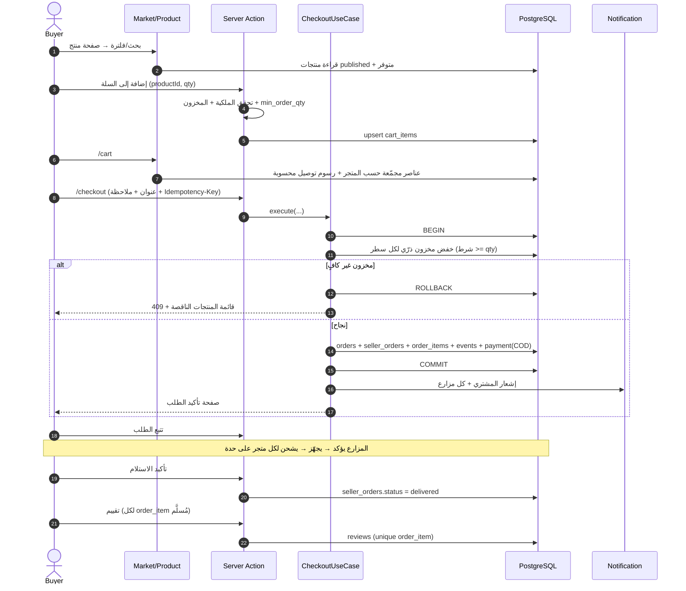
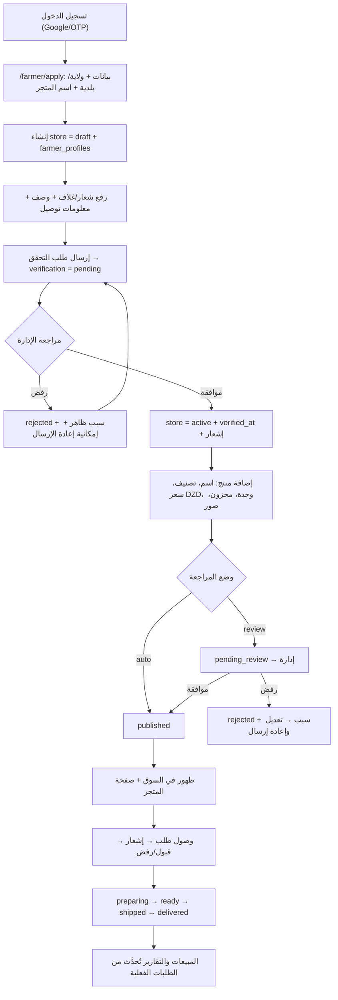
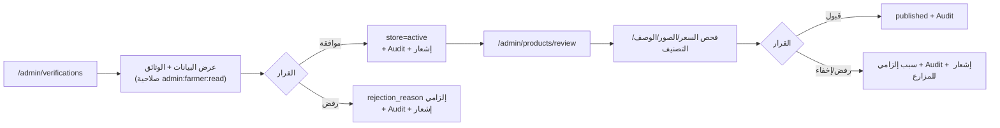
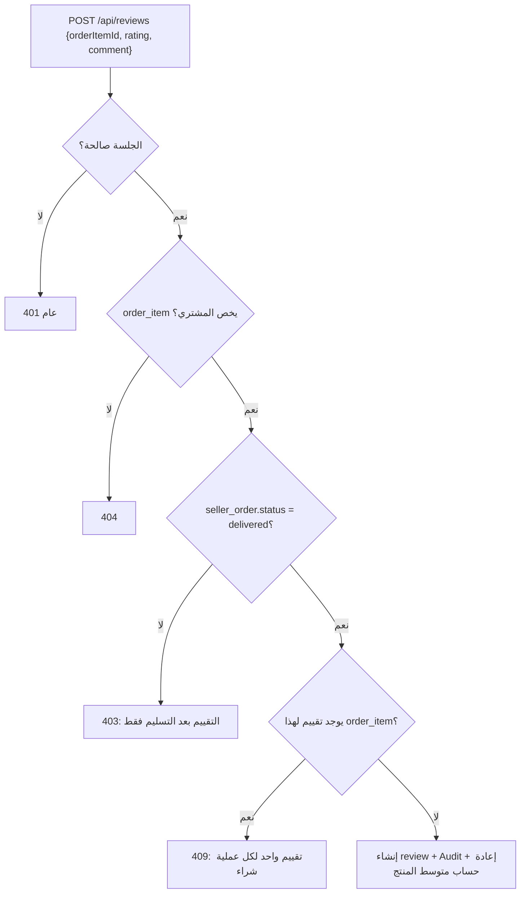

# 04 — Sitemap · تدفقات المستخدم · الهوية البصرية والصور واللغات

---

## 1. خريطة الصفحات (Sitemap)

```mermaid
flowchart TB
    ROOT["/ → /ar (إعادة توجيه حسب تفضيل اللغة)"]
    ROOT --> PUB["(public) عام"]
    ROOT --> AUTH["(auth) المصادقة"]
    ROOT --> BUY["(buyer) حساب المشتري"]
    ROOT --> FAR["(farmer)/dashboard"]
    ROOT --> ADM["(admin)/admin"]

    PUB --> P1["/ — الرئيسية"]
    PUB --> P2["/market — السوق + فلاتر"]
    PUB --> P3["/categories · /category/[slug]"]
    PUB --> P4["/product/[slug]"]
    PUB --> P5["/store/[slug]"]
    PUB --> P6["/about · /contact · /faq · /legal/privacy · /legal/terms · /legal/farmer-policy"]
    PUB --> P7["/join-farmer — دعوة المزارعين"]

    AUTH --> A1["/login"]
    AUTH --> A2["/verify — إدخال OTP"]
    AUTH --> A3["/farmer/apply — إنشاء متجر"]

    BUY --> B1["/account — ملفي"]
    BUY --> B2["/account/addresses"]
    BUY --> B3["/favorites"]
    BUY --> B4["/cart"]
    BUY --> B5["/checkout"]
    BUY --> B6["/orders · /orders/[number]"]
    BUY --> B7["/account/reviews"]
    BUY --> B8["/account/notifications · /account/sessions"]

    FAR --> F1["/dashboard — نظرة عامة"]
    FAR --> F2["/dashboard/products · new · [id]/edit"]
    FAR --> F3["/dashboard/inventory"]
    FAR --> F4["/dashboard/orders · [number]"]
    FAR --> F5["/dashboard/sales · /dashboard/reports"]
    FAR --> F6["/dashboard/store · /dashboard/store/delivery"]
    FAR --> F7["/dashboard/verification"]
    FAR --> F8["/dashboard/profile · /dashboard/notifications"]

    ADM --> D1["/admin — المؤشرات"]
    ADM --> D2["/admin/users · /admin/users/[id]"]
    ADM --> D3["/admin/farmers · /admin/verifications"]
    ADM --> D4["/admin/products · /admin/products/review"]
    ADM --> D5["/admin/orders · /admin/orders/[number]"]
    ADM --> D6["/admin/categories · /admin/geography · /admin/delivery"]
    ADM --> D7["/admin/disputes · /admin/reports"]
    ADM --> D8["/admin/reports-analytics"]
    ADM --> D9["/admin/audit"]
    ADM --> D10["/admin/settings"]
    ADM --> D11["/admin/staff — Super Admin فقط"]
```

### جدول الصفحات (مع مصدر البيانات والحالات)

| المسار | الوصول | المحتوى الأساسي | مصدر البيانات | حالات إلزامية |
|---|---|---|---|---|
| `/` | عام | Hero + بحث + تصنيفات + منتجات منشورة + شرح الفكرة + CTA مزارع | `products` (published + متوفر) · `categories` | Empty (لا منتجات ⇒ دعوة المزارعين) · Loading · Error |
| `/market` | عام | Grid + فلاتر (تصنيف، ولاية، سعر، متجر) + فرز + Pagination | `products` + `stores` | Empty (لا نتائج) · فلترة بلا نتائج |
| `/product/[slug]` | عام | صور، سعر، وحدة، مخزون، وصف، متجر، توصيل، تقييمات، إضافة للسلة | `products` · `reviews` (published) · `shipping_rates` | 404 · Empty تقييمات · Out of stock |
| `/store/[slug]` | عام | غلاف، شعار، وصف، موقع، منتجات المتجر | `stores` + `products` | 404 · متجر معلّق ⇒ صفحة توضيحية |
| `/cart` | مصادق | عناصر مجمّعة **حسب المتجر** + توصيل لكل متجر + الإجمالي | `carts` + `cart_items` | Empty · تنبيه مخزون تغيّر |
| `/checkout` | مصادق | بيانات الاتصال، الولاية/البلدية، العنوان، ملاحظة، ملخص، COD | `addresses` · `communes` · `shipping_rates` | تعارض سعر/مخزون ⇒ 409 مرئي |
| `/orders` · `/orders/[number]` | مصادق (مالك) | قائمة وتفاصيل + Timeline + إلغاء/نزاع | `orders` · `seller_orders` · `order_status_events` | 404 · Empty |
| `/account/*` | مصادق | الملف، العناوين، المفضلة، التقييمات، الإشعارات، الجلسات | متعدد | Empty لكل قسم · Feedback للنجاح |
| `/dashboard` | مزارع | عدّادات + مبيعات + آخر الأنشطة | `products` · `seller_orders` | متجر غير نشط ⇒ Banner سبب |
| `/dashboard/products/*` | مزارع | جدول/نموذج إنشاء وتعديل + صور + حالة + مخزون | `products` · `inventory_items` | Empty · Validation واضح لكل حقل |
| `/dashboard/orders/*` | مزارع | طلبات متجره + أزرار انتقال الحالة المسموحة فقط | `seller_orders` | Empty · أزرار معطّلة بسبب مكتوب |
| `/dashboard/verification` | مزارع | حالة التحقق، رفع وثائق، ملاحظات المراجع | `store_verification_requests` | Pending/Rejected/Needs info |
| `/admin/*` | admin/super | جداول، فلاتر، إجراءات بصلاحيات | كل الجداول | Empty · Loading · Error · تأكيد قبل الإجراء الحسّاس |
| `/admin/audit` | super | سجل تدقيق قابل للفلترة والتصدير | `audit_logs` | Empty |
| `/admin/staff` | super | إنشاء/تعليق مشرفين ومنح أدوار | `users` · `user_roles` | منع إسقاط آخر Super Admin |

**قاعدة UX:** كل جدول إداري يدعم: بحث، فلاتر، Pagination، فرز، حالة فراغ، و«لماذا هذا الزر معطّل؟» عبر Tooltip نصي لا لون فقط.

---

## 2. تدفقات المستخدم (User Flows)

### 2.1 المشتري: من البحث إلى استلام الطلب (متعدد المزارعين)

### 2.2 المزارع: من التسجيل إلى استقبال أول طلب

### 2.3 الإدارة: مراجعة مزارع ثم منتج

### 2.4 أهلية التقييم (منع التقييمات الوهمية)

---

## 3. الهوية البصرية ونظام التصميم (Design Tokens)

### 3.1 الألوان
| Token | القيمة | الاستخدام |
|---|---|---|
| `--color-forest` | `#244A35` | العناوين، الأزرار الأساسية، الهيدر الداكن |
| `--color-leaf` | `#6B9A62` | تفاعلي ثانوي، روابط، حالات نجاح |
| `--color-soft-green` | `#D9E5CF` | خلفيات شرائح، Badges، حالات محددة |
| `--color-canvas` | `#F5F0E5` | خلفية الصفحة الدافئة |
| `--color-white` | `#FFFFFF` | البطاقات والأسطح |
| `--color-ink` | `#1F2D24` | النص الأساسي |
| `--color-ink-muted` | `#5B6B60` (مشتق) | نص ثانوي — تباين ≥ 4.5:1 على الأبيض والـ Canvas |
| `--color-border` | `#E3E0D4` (مشتق) | حدود خفيفة |
| `--color-danger` | `#A63D2F` | أخطاء وإلغاء (يُستخدم مع أيقونة ونص، لا لون فقط) |
| `--color-warning` | `#B07C2A` | تنبيهات |
| `--color-info` | `#2F5D7C` | معلومات |

> كل أزواج النص/الخلفية تُفحص للوصول إلى **WCAG AA**. اللون الأخضر الفاتح `#6B9A62` **لا** يُستخدم لنص صغير على أبيض إلا بحد تباين مُقاس.

### 3.2 الخطوط والمقاسات
- `font-ar`: **Tajawal** (400/500/700) · `font-latin`: **Inter** (400/500/600/700).
- تحميل عبر `next/font/google` مع `subsets: ['arabic','latin']` و`display: 'swap'` و`preload` للخط الأساسي فقط.
- مقياس نص: `xs 12 · sm 14 · base 16 · lg 18 · xl 20 · 2xl 24 · 3xl 30 · 4xl 36` (مع `clamp()` للعروض).
- المسافات: مضاعفات 4px (`4, 8, 12, 16, 24, 32, 48, 64`).
- الزوايا: `sm 8 · md 12 · lg 16 · xl 24 · pill 999`.
- الظلال: `shadow-soft: 0 1px 2px rgba(31,45,36,.06), 0 8px 24px rgba(31,45,36,.06)` — بلا ظلال داكنة ثقيلة.
- الحركة: 150–220ms، `ease-out`، واحترام `prefers-reduced-motion`.

### 3.3 المكوّنات الأساسية
`Button` (primary/secondary/ghost/danger + loading + disabled) · `Input`/`Textarea`/`Select`/`Combobox` · `Checkbox`/`Radio` · `FormField` (Label + hint + error مرتبط بـ `aria-describedby`) · `Card` · `ProductCard` · `Price` · `Badge` (حالة منتج/طلب) · `Table` (قابل للفرز ومتجاوب) · `Dialog`/`ConfirmDialog` · `Drawer` (سلة/فلاتر موبايل) · `Toast` · `EmptyState` · `ErrorState` · `Skeleton` · `Pagination` · `Breadcrumbs` · `Tabs` · `Timeline` (تتبع الطلب) · `Stepper` · `FileUpload` (سحب وإفلات + معاينة + تحقق) · `Rating` · `LanguageSwitcher` · `StatCard` · `DataTable` إداري.

**نمط الحالات لكل صفحة:** `loading.tsx` (Skeleton مطابق للتخطيط) · `error.tsx` (رسالة مفهومة + إعادة محاولة + رمز مرجعي) · Empty State (نص + سبب + إجراء واضح) · Success (Toast + تحديث فوري للبيانات).

### 3.4 تجربة RTL/LTR
- `<html lang dir>` يُحدَّد من الـ locale على الخادم (`ar → rtl`, `fr/en → ltr`).
- استخدام الخصائص المنطقية فقط: `ms-*`, `me-*`, `ps-*`, `pe-*`, `start-*`, `end-*` — لا `ml/mr` إلا في حالات استثنائية موثّقة.
- أيقونات الأسهم تُقلب بـ `rtl:rotate-180`؛ شريط التقدم والرسوم تُقلب منطقيًا.
- الأرقام: `tabular-nums` في الجداول والأسعار، وتنسيق `Intl` حسب اللغة (`1 250,00 DA` / `1.250,00 DA`).

---

## 4. سياسة الصور (إلزامية وصارمة)

### 4.1 محظور تمامًا
لا صور لأشخاص أو وجوه أو أجساد أو أيدي بشرية، ولا حيوانات أو طيور أو حشرات، ولا شخصيات كرتونية/رسوم لكائنات حيّة، ولا ظلال/Silhouettes لكائنات حيّة. **ولا صور مولَّدة بالذكاء الاصطناعي في أي جزء من المنصة** — بما في ذلك الصور التحريرية والـ Placeholder.

### 4.2 ما نستخدمه وأين
| الاستخدام | المصدر | التخزين |
|---|---|---|
| صورة Hero، بطاقات التصنيفات، صور الصفحات التعريفية | Unsplash / Pexels / Pixabay — صور **حقيقية فوتوغرافية** لخضروات، حقول، تربة، أدوات ري، صناديق محاصيل، بلا كائنات حيّة | تُنزَّل وتُخزَّن في `public/images/editorial/` أو Blob بعد التحقق، مع سجل ترخيص في `docs/asset-licenses.md` (المصدر، الرابط، الرخصة، تاريخ التنزيل) |
| صور المنتجات | **المزارع فقط** يرفعها | Blob + `media_assets` |
| لا يوجد منتج/صورة | Placeholder محايد مرسوم بـ CSS/SVG (إطار + أيقونة ورقة + نص «لا توجد صورة») | كود، بلا صورة منتج مزيفة |

**قاعدة حاسمة:** لا نضع صورًا «تشبه منتجًا للبيع» في بطاقات منتجات غير موجودة. البذور لا تضيف منتجات أصلًا.

### 4.3 الترخيص
- **Unsplash License**: مجاني للاستخدام التجاري، بلا إتاحة إلزامية، مع منع إعادة بيع الصور كمنتج أو استخدامها لبناء خدمة مشابهة.
- **Pexels License** و**Pixabay Content License**: استخدام تجاري مسموح مع قيود مشابهة.
- توثيق كل صورة في سجل الترخيص + الاحتفاظ بنسخة من شروط المصدر وقت التنزيل.
- ممنوع تحميل صور عشوائية من محركات البحث أو مصادر غير مرخّصة.
- روابط دائمة فقط: بعد التنزيل والتحقق تُخزَّن نسخة لدينا (لا نعتمد على روابط CDN مؤقتة).

### 4.4 التنفيذ التقني
- `next/image` دائمًا؛ `images.remotePatterns` **بقائمة نطاقات محددة** (`*.public.blob.vercel-storage.com`) — لا wildcards عامة، ولا `dangerouslyAllowSVG` إلا لملفات داخلية موثوقة.
- تحويل تلقائي إلى AVIF/WebP، `sizes` دقيقة لكل Breakpoint، `priority` للـ Hero فقط، والباقي Lazy.
- `alt` إلزامي ومترجم (وصف المنتج من المزارع، لا تكرار نصي).
- سكربت `scripts/check-images.ts` في CI: يرفض أي صورة بلا سجل ترخيص، أو تحوي Metadata تصوير أشخاص (EXIF GPS/اسم)، ويتحقق من العرض/الحجم.

---

## 5. اللغات والتعددية الثقافية (i18n)

| البند | القرار |
|---|---|
| المكتبة | `next-intl` 4.x، توجيه `/{locale}`، locales: `ar` (افتراضي) · `fr` · `en` (قابل للتعطيل بـ feature flag) |
| الملفات | `src/i18n/messages/{ar,fr,en}.json` مقسّمة بنطاقات (`common`, `auth`, `catalog`, `cart`, `orders`, `farmer`, `admin`, `errors`, `legal`) |
| المنع | لا نص عربي/فرنسي داخل JSX، ولا `t()` بمفاتيح ديناميكية غير مُتحقَّقة (سكربت `verify-i18n` يفشل عند مفتاح ناقص أو زائد) |
| تنسيق | `Intl.NumberFormat` للأسعار، `Intl.DateTimeFormat` للتواريخ بـ `Africa/Algiers`، أسماء الولايات والتصنيفات من الأعمدة الثلاثة في DB |
| التفضيل | `users.default_locale` + Cookie؛ الزائر يُوجَّه حسب `Accept-Language` |
| الجمع | ICU pluralization (`{count, plural, ...}`) — العربية تحتاج صيغ zero/one/two/few/many/other |
| RTL | `dir` من الخادم + خصائص منطقية + مراجعة بصرية لكل صفحة بلغتين |
| SEO | `hreflang` متبادل لكل صفحة + `canonical` لكل لغة + Metadata مترجمة |
| الأخطاء | رموز أخطاء (`auth.otp.invalid`) تُترجم في الواجهة، لا نصوص إنجليزية خام |

---

## 6. إمكانية الوصول (Accessibility)
- هدف WCAG 2.2 AA: تباين 4.5:1، أهداف لمس ≥ 44px، `focus-visible` واضح، `prefers-reduced-motion`.
- تنقّل كامل بلوحة المفاتيح، Skip link، ترتيب Focus منطقي، `role="alert"` لرسائل الخطأ الحيّة.
- Labels حقيقية لكل حقل (لا `placeholder` كبديل)، `aria-invalid` + وصف الخطأ مرتبط.
- الجداول: `<th scope>`، وأزرار أيقونية تحمل `aria-label`.
- الصور الزخرفية `alt=""`، والحقيقية وصفية.
- اختبارات: فحص آلي (axe) في Playwright + مراجعة يدوية للتدفقات الحرجة بلغة `ar` (RTL).

---

## 7. مبادئ تجربة الشاشات الحرجة
1. **السلة** تُظهر التجميع حسب المتجر ورسوم كل متجر، وتُنبّه فورًا إذا تغيّر المخزون أو السعر.
2. **Checkout** خطوة واحدة بصفحة واحدة (لا Wizard)، مع ملخص ثابت يُظهر: المجموع، التوصيل لكل متجر، الإجمالي النهائي، وطريقة الدفع الوحيدة المتاحة (COD) بوصف صريح «الدفع عند الاستلام».
3. **لوحة المزارع** تبدأ بما يحتاج انتباهه: طلبات تنتظر التأكيد، مخزون منخفض، منتجات مرفوضة مع السبب.
4. **لوحة الإدارة** تفتح على ما يحتاج إجراءً: طلبات تحقق، منتجات للمراجعة، طلبات متأخرة، نزاعات مفتوحة.
5. **لا أزرار كاذبة:** أي ميزة غير منفذة تظهر معطّلة مع سبب («الدفع الإلكتروني غير متاح حاليًا»)، ولا تُنشئ وهم اكتمال.
