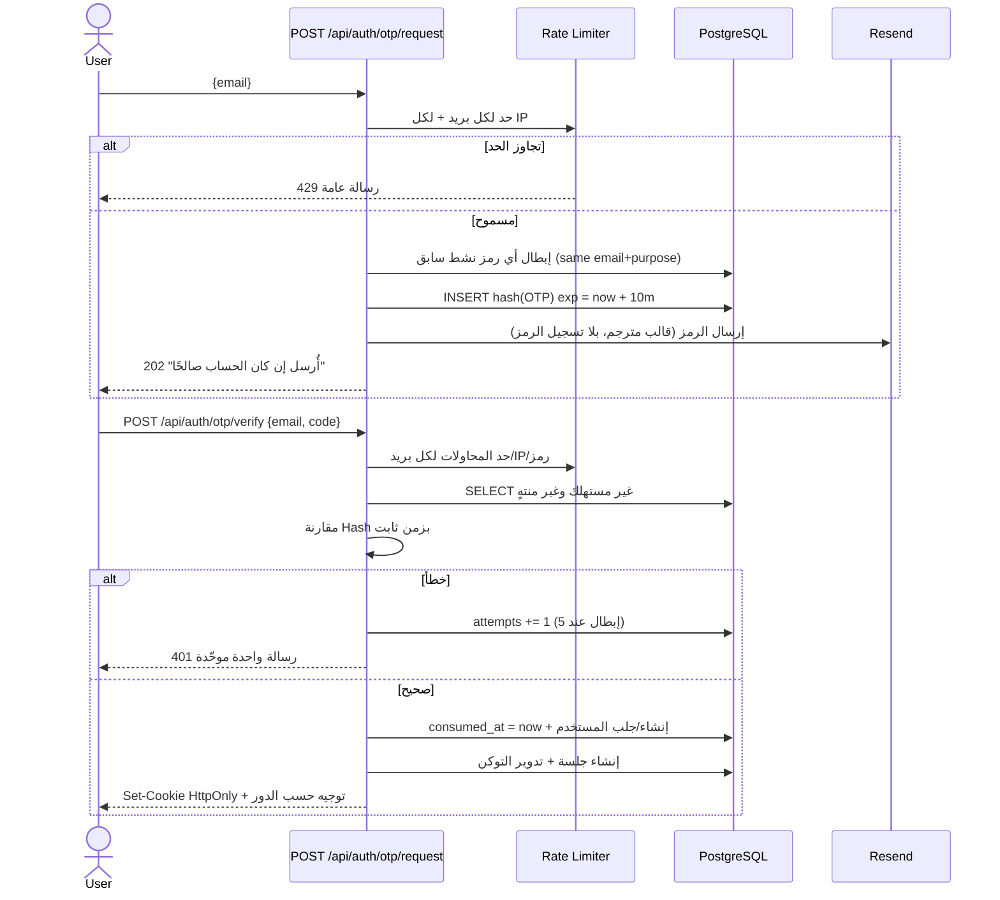
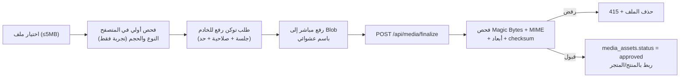

# 05 — معمارية الأمان ونموذج التهديدات

> مبدأ: **Security by Design** + **Least Privilege** + **لا ثقة بمدخلات المتصفح**.
> **تحذير صريح:** لا يوجد نظام «آمن بالكامل». هذا المستند يحدد الضوابط والاختبارات والمخاطر المتبقية المعروفة؛ وسيُحدَّث مع كل مرحلة، ولن ندّعي نجاح اختبار لم يُشغَّل.

---

## 1. نموذج التهديدات (STRIDE)

| النوع | السيناريو الفعلي في AgriDirect | الضابط | اختبار التحقق |
|---|---|---|---|
| **Spoofing** | انتحال مستخدم عبر جلسة مسروقة أو OAuth مزوّر | جلسات DB بتوكن مُهشَّر، `HttpOnly/Secure/SameSite`, تدوير بعد الدخول، تحقق `state`+`nonce`+`PKCE` في OIDC، مقارنة `iss/aud/exp` | اختبار جلسة ملغاة/منتهية؛ اختبار callback بحالة مغلوطة |
| **Tampering** | تعديل السعر/الكمية/الإجمالي في الطلب، تعديل `storeId` | الخادم يعيد كل الحسابات من DB، `zod` يرفض حقولًا غير معروفة (منع Mass Assignment)، مقارنة إجمالي العميل ⇒ 409 | اختبار إرسال سعر مزيّف وكمية سالبة |
| **Repudiation** | مزارع/مشرف ينكر إجراءً (رفض منتج، إلغاء طلب) | `audit_logs` مُلحَق فقط + `order_status_events` بكل انتقال | اختبار تسجيل سبب وفاعل لكل إجراء حسّاس |
| **Information Disclosure** | قراءة طلب/منتج/وثيقة ليست لك؛ رسائل خطأ تكشف وجود مورد | استعلامات مقيّدة بالمالك، **404** بدل 403 للموارد الملكية، رسائل خطأ عامة للجمهور، منع Stack Traces، صور الوثائق غير عامة | مجموعة اختبارات IDOR/BOLA |
| **Denial of Service** | إغراق OTP/الدخول/البحث/الرفع | Rate limit متعدد المستويات + حد حجم الرفع + Pagination إلزامية + `statement_timeout` + قيود بحث | اختبار تجاوز الحدود |
| **Elevation of Privilege** | مستخدم عادي يصل `/admin` أو يستدعي API إداريًا | RBAC من DB + Guard في كل Use Case + منع `super_admin` لنفسه | اختبار دور مزيّف في Cookie + API مباشر |
| **CSRF** | إجراء كتابة من موقع آخر عبر Cookie | Server Actions (حماية مدمجة للأصل) + فحص `Origin/Host` + `SameSite=Lax` + لا GET للكتابة | اختبار طلب من أصل خارجي |
| **Supply Chain** | حزمة npm مخترقة/خطأ إملائي | تثبيت الإصدارات، lockfile مُلتزَم، `pnpm audit` في CI، تقليل الاعتماديات، مراجعة أي حزمة جديدة | `pnpm audit --prod` في CI |
| **SSRF** | رابط صورة خارجي يُجلب من الخادم | لا نجلب روابط مستخدم لا من قائمة نطاقات مسموحة، ورفع الملفات عبر token مباشر إلى Blob | اختبار رفع URL خارجي |
| **Insider / Admin Abuse** | Admin يعدّل طلبًا أو يعلّق حسابًا بلا رقابة | فصل `admin`/`super_admin`، سبب إلزامي، سجل تدقيق غير قابل للتعديل، لا وصول لكلمات مرور/OTP | مراجعة سجل التدقيق |
| **PII Leak** | تسريب هاتف/عنوان في Logs أو رسائل خطأ | تنقيح `pino` لحقول محددة، لا OTP ولا tokens في السجلات، هاتف المشتري يُعرض للمزارع الذي لديه طلب فقط | فحص سجلات اختبارية |
| **File Upload Attack** | `.php`/`.svg` خبيث، صورة مضغوطة تفجيرية (decompression bomb) | فحص Magic Bytes + حد أبعاد/حجم + منع SVG + إعادة ترميز عند الإمكان + مفاتيح عشوائية | اختبارات رفع ملفات مرفوضة |

---

## 2. المصادقة (Authentication)

### 2.1 القرار: Passwordless في v1
- طريقتان فقط: **Google (OIDC)** و**Email OTP (6 أرقام)**.
- **لا كلمة مرور، ولا `password_hash` في v1** ⇒ إزالة كاملة لطبقة مخاطر كلمات المرور. Better Auth يستطيع إضافة Email+Password لاحقًا (صف `account` من نوع `credential`) دون تغيير مخطط المستخدمين.
- المتطلب «تغيير كلمة المرور عند استخدام مصادقة البريد وكلمة المرور» يُترجم إلى: **إدارة الجلسات + تغيير البريد + إبطال كل الأجهزة** — لا واجهة كلمة مرور وهمية.

### 2.2 تدفق Email OTP

**مواصفات إلزامية للرمز**

| الخاصية | القيمة |
|---|---|
| التوليد | `crypto.randomInt(0, 1_000_000)` مُثبَّت على 6 أرقام، مصدر عشوائي آمن |
| التخزين | **Hash** (Argon2id أو HMAC-SHA256 بمفتاح سري للرموز قصيرة العمر) — لا يُخزَّن الرمز الصريح ولا يُسجَّل في Logs |
| الصلاحية | 10 دقائق |
| الاستخدام | مرة واحدة؛ يُستهلك في نفس المعاملة التي أنشأت الجلسة |
| المحاولات | 5 كحد أقصى للرمز الواحد، ثم إبطاله |
| إعادة الإرسال | تهدئة 60 ثانية، وحد أقصى 5 رموز/ساعة لكل بريد و10/IP |
| ربط البريد | إن كان البريد مسجّلًا عبر Google، تسجيل الدخول بالـ OTP يربط بنفس الحساب بعد التحقق — لا حساب مكرر |
| العدّاد/التخزين | جدول `auth_otp_codes` بفهرس `(email, purpose, created_at)` |
| الرسائل | «رمز غير صالح أو منتهٍ» موحّدة — **لا** كشف إن كان البريد مسجّلًا |

### 2.3 Google OAuth 2.0 / OIDC
- `client_id` عام في الواجهة مسموح؛ **`client_secret` على الخادم فقط** (`GOOGLE_CLIENT_SECRET`)، ولا يظهر في أي Bundle.
- `redirect_uri` ثابت مسجّل مسبقًا؛ رفض أي redirect ديناميكي (منع Open Redirect).
- تحقق من `state` و`nonce` و`PKCE`، والتوقيع، و`iss = accounts.google.com`، و`aud = client_id`.
- قبول الربط بحساب موجود **فقط** إذا كان `email_verified = true` من Google ومطابقًا للبريد الموجود؛ وإلا ⇒ إنشاء مستخدم جديد.
- رفض الدخول إذا `user_status != active` بعد التحقق، مع تسجيل الحدث.
- إلغاء الموافقة/فشل Callback ⇒ صفحة خطأ مفهومة مع إعادة محاولة، بلا تسريب تفاصيل.

### 2.4 الجلسات
| البند | القرار |
|---|---|
| التخزين | DB (`sessions`) بتوكن عشوائي 256-bit، يُخزَّن **Hash** فقط |
| الكوكي | `HttpOnly`, `Secure`, `SameSite=Lax`, `Path=/`, `__Host-` prefix في الإنتاج |
| المدة | Sliding 7 أيام بحد أقصى مطلق 30 يومًا |
| التدوير | توكن جديد عند الدخول وعند تغيّر مستوى الحساسية (ربط بريد/تغيير دور) |
| الإبطال | خروج، خروج من كل الأجهزة، تعليق الحساب، تغيير الدور الحسّاس ⇒ إبطال فوري لكل الجلسات |
| العرض | `/account/sessions` و`/dashboard/profile`: الجهاز (UA مختصر)، آخر استخدام، IP مُقنَّع (مثال `41.100.*.*`)، زر إبطال |
| Session Fixation | لا تُقبل جلسة من عنوان/باراميتر؛ تُنشأ فقط من الخادم بعد تحقق |
| الذاكرة المؤقتة | استعلامات الصلاحيات والجلسة بلا Cache عبر الحسابات؛ صفحات الحساب `Cache-Control: private, no-store` |

### 2.5 الحماية من CSRF وBrute Force
- الكتابة عبر Server Actions (حماية الأصل المدمجة في Next) أو POST فقط مع فحص `Origin`/`Sec-Fetch-Site`.
- لا عمليات كتابة عبر `GET`.
- قفل تدريجي: بعد 5 محاولات OTP خاطئة ⇒ إبطال الرمز؛ بعد 10 محاولات دخول من IP ⇒ حجب مؤقت 15 دقيقة؛ كل الحدود في Redis (أو Postgres كبديل).
- حماية التعداد (Enumeration): ردود موحّدة على طلب OTP، و404 على الموارد الملكية.

---

## 3. رؤوس الأمان (Security Headers)

| الرأس | القيمة المقترحة | ملاحظة |
|---|---|---|
| `Strict-Transport-Security` | `max-age=63072000; includeSubDomains; preload` | HTTPS إلزامي (Vercel يوفّره) |
| `Content-Security-Policy` | `default-src 'self'; script-src 'self' 'nonce-<n>' 'strict-dynamic'; style-src 'self' 'nonce-<n>'; img-src 'self' data: blob: https://*.public.blob.vercel-storage.com; font-src 'self'; connect-src 'self' https://vitals.vercel-insights.com; frame-ancestors 'none'; form-action 'self'; base-uri 'none'; object-src 'none'` | Nonce لكل طلب من middleware؛ لا `unsafe-inline` للسكربتات |
| `X-Content-Type-Options` | `nosniff` | — |
| `Referrer-Policy` | `strict-origin-when-cross-origin` | — |
| `X-Frame-Options` / `frame-ancestors` | `DENY` / `'none'` | منع Clickjacking |
| `Permissions-Policy` | `camera=(), microphone=(), geolocation=(), payment=()` | لا حاجة لها الآن |
| `Cross-Origin-Opener-Policy` | `same-origin` | — |
| CORS | لا `Access-Control-Allow-Origin` مفتوح؛ نفس الأصل فقط. أي تكامل مستقبلي يُحدَّد بنطاق صريح | لا حاجة لـ CORS عبر نطاقات في v1 |

تطبيقها في `src/server/security/headers.ts` + `next.config.ts`، وتُتحقَّق في CI باختبار يقرأ رؤوس الاستجابة.

---

## 4. حدود المعدل (Rate Limiting)

| المسار | الحد | المفتاح |
|---|---|---|
| `POST /api/auth/otp/request` | 5/ساعة | بريد + IP |
| `POST /api/auth/otp/verify` | 10/10 دقائق | بريد + IP + رمز |
| OAuth callback | 20/10 دقائق | IP |
| البحث `?q=` | 30/دقيقة | IP + جلسة |
| إنشاء طلب | 5/دقيقة | مستخدم |
| رفع صورة | 20/ساعة | مستخدم |
| كتابة عامة (تقييم/بلاغ) | 10/ساعة | مستخدم |
| تسجيل دخول إداري | 5/10 دقائق | IP + بريد |

التنفيذ: `@upstash/ratelimit` (Redis) مع **fallback** على جدول `rate_limit_buckets` في Postgres عند عدم توفر Redis، حتى لا تتعطّل المصادقة في بيئة التطوير. فشل الـ limiter ⇒ سلوك **مغلق (fail-closed)** لمسارات المصادقة.

---

## 5. رفع الملفات والصور

- الأنواع المسموحة: `image/jpeg`, `image/png`, `image/webp`, `image/avif`. **ممنوع SVG** (XSS عبر سكربت مضمّن) وأي ملف تنفيذي.
- التحقق من النوع من **أول بايتات الملف** لا من `Content-Type` أو الامتداد.
- حد 5MB للصورة، وحد أبعاد (مثل 6000×6000) لمنع decompression bombs.
- أسماء عشوائية (UUID) ⇒ لا Path Traversal ولا تخمين.
- ملفات النزاعات (`dispute_evidence`) خاصة: روابط موقّعة قصيرة العمر، لا تُخزَّن في مسار عام، ولا تُعرض إلا لأطراف النزاع والمشرف.
- إعادة الترميز: Vercel لا يوفر ImageMagick؛ لذلك نعتمد التحقق الصارم + العرض عبر `next/image` (الذي يعيد الترميز للصيغ المدعومة). **خطر متبقٍ موثّق**: صور تحمل بيانات EXIF/محتوى غير مرئي؛ نزيل EXIF عند المعالجة إن أمكن، وإلا نرشّح عبر خدمة تحويل (Cloudinary) إذا اشتدّت الحاجة.

---

## 6. سجل التدقيق (Audit Log)

| البند | القرار |
|---|---|
| الجدول | `audit_logs` — إلحاق فقط |
| الحماية | `REVOKE UPDATE, DELETE ON audit_logs FROM app_role` في migration + لا واجهة حذف |
| الحقول | `actor_user_id`, `actor_role`, `action`, `resource_type`, `resource_id`, `result`, `reason`, `ip_hash`, `user_agent_hash`, `metadata jsonb`, `created_at` |
| التنقيح | `metadata` يمر بفلتر يحذف `email?` (يُقنَّع)، `phone` (يُقنَّع)، أي `token|otp|secret|password|authorization` |
| الأحداث | دخول/خروج، فشل مصادقة متكرر، منح/سحب دور، تعليق حساب/متجر، تحقق مزارع، نشر/رفض/إخفاء منتج، تدخل في طلب، حل نزاع، تعديل إعداد حسّاس، تصدير بيانات، رفض صلاحية |
| الاحتفاظ | ≥ 24 شهرًا (قابل للضبط)، ونسخ احتياطي منفصل |
| العرض | `/admin/audit` بفلاتر (الفاعل، النوع، المورد، التاريخ، النتيجة)؛ `admin` يرى عملياته وما يخص موارده فقط، `super` يرى الكل |

**ما لا يُسجَّل أبدًا:** رموز OTP، التوكنات، أسرار الجلسات، محتوى كلمات المرور (غير موجودة)، تفاصيل الدفع الكاملة.

---

## 7. حماية البيانات والخصوصية

- **الحد الأدنى من البيانات:** لا نطلب رقم هوية وطنية في v1. وثائق المزارع اختيارية بحسب سياسة التحقق، وتُخزَّن خاصة، وتُحذف بعد انتهاء الحاجة أو عند إغلاق الحساب وفق السياسة.
- **PII في قاعدة البيانات:** البريد/الهاتف/العنوان. الوصول مقيّد بالملكية والصلاحية، ولا تُصدَّر كاملة إلا بـ `super:data:export` مع Audit.
- **التشفير:** TLS لكل الاتصالات (Vercel/Neon)، وتشفير القرص على مستوى المزود. أي حقل عالي الحساسية مستقبلًا (وثائق) يُشفَّر على مستوى التطبيق بمفتاح في متغيرات البيئة، لا في الكود.
- **Logs:** `pino` + قائمة حقول محظورة؛ `console.log` ممنوع في الإنتاج (قاعدة ESLint).
- **الاحتفاظ:** الطلبات والفواتير تبقى (سجل تجاري)؛ العناوين/المفضلة تُحذف Soft ثم نهائيًا بعد فترة؛ طلب حذف الحساب يجهّز الحذف مع الإبقاء على الحد الأدنى القانوني (طلبات بلا بيانات شخصية مباشرة).
- **الإطار القانوني الجزائري:** التصميم يراعي القانون 18-07 المتعلق بحماية الأشخاص الطبيعيين في معالجة المعطيات ذات الطابع الشخصي (موافقة، غرض محدد، حق الوصول والتصحيح)، مع صفحة خصوصية صريحة ومترجمة. **هذا ليس استشارة قانونية** — تُراجع الصياغة النهائية قانونيًا قبل الإطلاق.

---

## 8. الأسرار وإدارة البيئة

| السر | المكان | من يملكه |
|---|---|---|
| `DATABASE_URL` / `DIRECT_URL` | Vercel Encrypted Env (Production/Preview منفصلة) | DevOps |
| `BETTER_AUTH_SECRET` | متغير بيئة عشوائي 32+ بايت | DevOps |
| `GOOGLE_CLIENT_SECRET` | Vercel Env فقط | DevOps |
| `RESEND_API_KEY` | Vercel Env فقط | DevOps |
| `BLOB_READ_WRITE_TOKEN` | Vercel Env فقط | DevOps |
| `UPSTASH_REDIS_*` | Vercel Env فقط | DevOps |
| `OTP_HASH_PEPPER` | Vercel Env فقط | DevOps |

- `.env.example` يحتوي **أسماء المتغيرات فقط** بوصف، لا قيم.
- تحقق إقلاع عبر Zod: التطبيق يفشل بوضوح إن نقص متغير حرج في الإنتاج.
- `NEXT_PUBLIC_*` للقيم العامة فقط — لا أسرار.
- لا مفاتيح في Git، ولا في لقطات الشاشة، ولا في Logs. فحص سري في CI (`gitleaks`) + `git-secrets` محليًا.

---

## 9. استمرارية الخدمة والنسخ الاحتياطي

| البند | القرار |
|---|---|
| نسخ Neon | Point-in-Time Recovery (نافذة 7 أيام على خطة الفريق) + فرع احتياطي قبل كل migration إنتاجي |
| اختبار الاستعادة | استعادة تجريبية على فرع منفصل مرة كل دورة إصدار، موثّقة بالتاريخ والنتيجة |
| الترحيلات | `migrate deploy` في CI فقط، مع فحص `drift` ومنع `db push` |
| التراجع | Vercel Rollback للنسخة السابقة + خطة تراجع بيانات مكتوبة لكل migration خطر |
| المراقبة | Sentry للأخطاء (إن فُعّل) + تحقق `/api/health` (DB + إعدادات) + تنبيه على ارتفاع 5xx |
| وضع الصيانة | `platform_settings.maintenance_mode` يوقف الكتابة ورسالة واضحة |

---

## 10. المخاطر المتبقية المعروفة (نُعلنها بوضوح)

| # | الخطر المتبقي | الأثر | التخفيف / الخطة |
|---|---|---|---|
| 1 | لا يوجد دفع إلكتروني؛ COD فقط | نزاعات «لم يُدفع» | تتبع حالة الدفع اليدوي + سجل نزاعات + إثبات تسليم |
| 2 | لا إعادة ترميز كاملة للصور على Vercel | صور تحمل بيانات وصفية | فحص صارم + حد أبعاد + خطة Cloudinary للتحويل |
| 3 | التحقق من هوية المزارع يعتمد على مراجعة بشرية | احتيال محتمل | سياسة وثائق + تعليق سريع + Audit |
| 4 | تجربة `admin` تملك وصولًا واسعًا | إساءة استخدام | فصل `super_admin`، سبب إلزامي، سجل غير قابل للتعديل |
| 5 | لا تدقيق أمني خارجي (Pen Test) بعد | ثغرات غير معروفة | اختبارات أمنية آلية + مراجعة كود + Pen Test قبل الإطلاق التجاري |
| 6 | الاعتماد على مزود واحد (Vercel/Neon) | تعطّل المزود | تصدير PITR + كود قابل للنقل (Postgres قياسي، لا اعتماد على واجهات خاصة) |
| 7 | البريد (Resend) قد يقع في Spam | تعذّر الدخول عبر OTP | SPF/DKIM/DMARC + بريد بديل + تنبيه |
| 8 | لا يوجد حد لعدد الجلسات لكل مستخدم | استنزاف موارد | حد أقصى 10 جلسات نشطة، وإبطال الأقدم |
| 9 | البحث النصي العربي | جودة نتائج ضعيفة | `tsvector` مع إعداد `simple` أولًا، ثم `pg_trgm`/قاموس عربي إذا لزم |
| 10 | لا اختبارات حمل بعد | أداء غير معروف تحت الضغط | اختبار حمل على مسار السوق والـ checkout قبل الإطلاق العام |

---

## 11. قائمة تحقق أمنية قبل كل إصدار (Release Gate)
1. `pnpm audit --prod` بلا ثغرات عالية/حرجة غير معالَجة.
2. `typecheck` + `lint` + اختبارات وحدة/تكامل/أمنية خضراء.
3. فحص رؤوس الأمان فعليًا على بيئة Preview.
4. اختبار IDOR على 3 موارد مختلفة على الأقل.
5. مراجعة أي migration جديد (خصوصًا `DROP`/`ALTER TYPE`/`REVOKE`).
6. تأكيد عدم وجود أسرار في Diff (`gitleaks`).
7. تأكيد أن كل إجراء حسّاس جديد يكتب Audit بسبب.
8. تأكيد أن كل الصفحات الخاصة `noindex` ولا تُخزَّن مؤقتًا.
